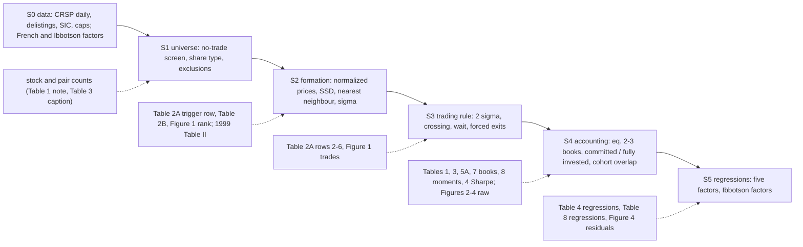
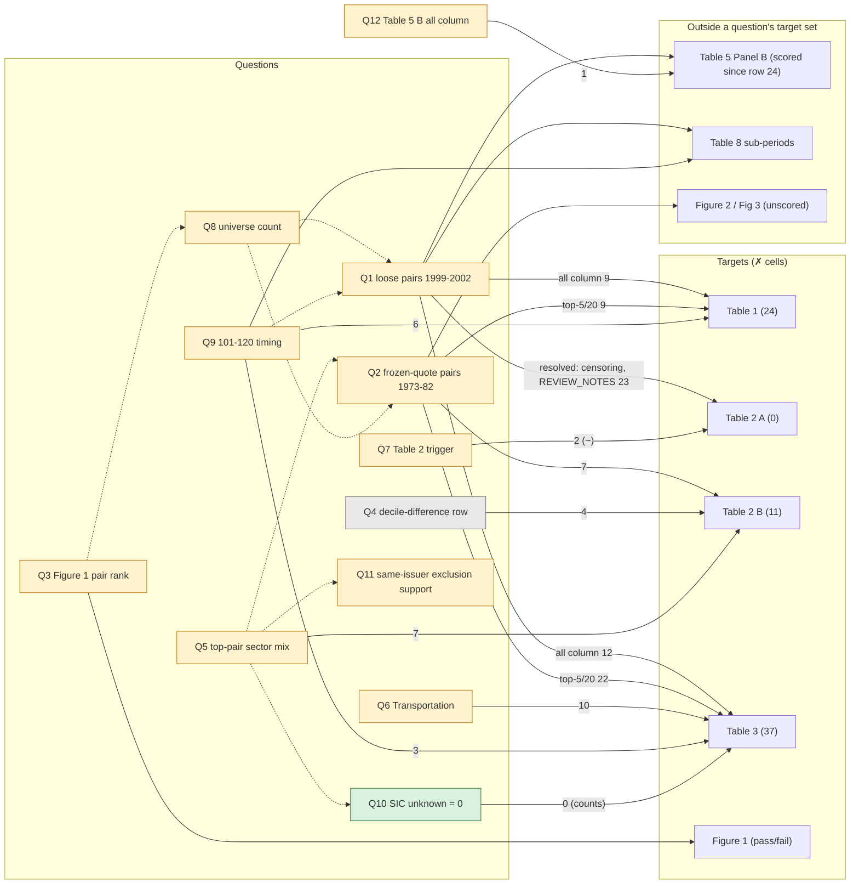

# Gaps: why the cells miss, what is still open, and the paper's own arithmetic

One home for everything that stands between this replication and the paper's numbers:
which cells share a cause and how to report them in stages (sections 1-7); the
open-question tracker Q1-Q12 with its graph and evidence, the ✗ partition and the table of
closed levers (sections 8-10); what the
paper's own printed statistics imply about the reversal factor it never names
(section 11); and the reversal-factor audit's record (section 12). The dated
experiment rounds that produced these findings are archived verbatim in
`archive/OPEN_QUESTIONS_ROUNDS.md`; the running log of what was tried, in date order
and with the scores of their day, is `REVIEW_NOTES.md`. `REPLICATION_CHECK.md` answers
"how close is cell X"; this page answers "which cells share a cause, and can any
convention move them".

Compiled 2026-11-17 against SCORE_LOG row 29 (411.0 of 865 cells, every distinct printed result:
✓ 322, ~ 178, ✗ 365), the base after PR #64, after Tables 9 Panel A, 9 Panel B, 6 and 5 Panel B
joined the scored set, after the five-factor block moved to the losers-only reversal series, after
the daily panel joined the cache (format 7) and after round 4's three shipped changes (French's
2005 factor files, Table 6's caption reading of committed capital, Table 9 B's same-day recall
close; `REVIEW_NOTES` 72, 74, 75). Every count of ✗ cells in this page was re-read from
`REPLICATION_CHECK.md` at that row; where a count differs from an older one in
`archive/OPEN_QUESTIONS_ROUNDS.md`, the check is right. Round 4 moved 23 marks, all in Tables 4,
6, 7, 8 and 9 B (section 2, base note for rows 27-29); every cell of Tables 1-3 is identical to row
26's, so the tracker's counts (section 8) hold on both bases.

Three things come out of the sections below, and each is worth holding onto before the
detail: **which cells share a cause**, so the replication can be reported in stages
rather than cell by cell, and so the next experiment is aimed at the stage that
generates a block of cells rather than at one of them; which causes no convention
choice can move; and which questions are still open.

Three things come out of it:

1. Every number the paper prints is produced by one of five stages. The first three stages
   (universe, formation, trading rule) are pinned by numbers that depend on nothing downstream,
   and they pass: the published pair and stock counts, the 1999 draft's trigger and composition
   rows, the trading statistics and Figure 1. The sector map in particular is not the bottleneck.
2. Of the 865 scored cells, 310 depend only on the location, dispersion and composition of the
   series, and they score 252.0 (81%). The other 555 cells fall into eight named causes, seven
   of which no convention choice can move: the paper's own arithmetic (69 cells), the published
   edition disagreeing with its own earlier edition (12), the paper's unrebuildable reversal
   factor (200), the third and fourth moments of a handful of months (160), the late period (14),
   the Ibbotson block (44), persistence (8), and the random-pair bootstrap, whose cells measure
   our own draws rather than the paper's (48, class I).
3. The last untried universe reading, that the published edition's 1997-2002 extension used a
   different stock population, is measured here (section 4) and closed: a Nasdaq-only late
   universe reproduces the published trigger and sector profile at every rank but not the
   returns or the pair count, so no universe fits both.

## 1. Five stages



Each stage is pinned by printed numbers that depend on that stage and the ones above it, not on
the ones below. A miss at a pin locates the cause at or above that stage.

| stage | what it fixes | pins (ours / paper) | verdict |
|---|---|---|---|
| S1 universe | which stocks can be paired | stocks 2,293 / 2,317; pairs 2,009 / 2,057; pairs opened 1,881 / 1,944 (Table 2 A's count); sectors 137 / 61 / 347 / 1,748 against 156 / 61 / 371 / 1,729; 1999 draft pairs 1,788 / 1,870 | within 1-7% on every count; Utilities 12% low, Financials 6% low (Q8, section 8) |
| S2 formation | which pairs, in what order, with what sigma | 1999 draft trigger, ours / draft on the draft's own window, 0.0399 / 0.0399, 0.0453 / 0.0449, 0.0704 / 0.0683, 0.162 / 0.152; Table 2B 101-120 and all-pair sector weights within 0.03 on all 8 cells; size rows 7 of 8 within 10%; Figure 1 pair rank 4 / 5 | reproduces the 1999 draft; the published Table 2A trigger (0.0476 / 0.0528) and top-5/20 mix differ from the draft by more than the sample extension (section 4) |
| S3 trading rule | when a pair opens and closes | Table 2A pairs traded 4.9 / 4.81, 19.7 / 19.3, 19.6 / 19.4, 1,881 / 1,944; round trips 2.24 / 2.02 to 1.66 / 1.62; months open 3.93 / 3.75 to 4.01 / 3.97; Figure 1 trades within 2 days | 17 ✓ / 5 ~ / 0 ✗ on Panel A's 22 cells outside the top-5 and top-20 trigger (those two are ~, Q7's, class B); the entry-only wait (160.5) and the rebased trading index (346.0 of 865, 143.5 on 291; `REVIEW_NOTES` 100) are refuted, the persistence clause is score-neutral (`METHOD.md` rows 11-13) |
| S4 accounting | monthly and daily series of each portfolio | Table 1 Panel B = Table 7 long minus short to 1 bp (identity, row 17); fully invested / committed ratios 1.54-1.75 / 1.59-1.80 (recomputed 2026-11-17, `METHOD.md` row 17); Table 5 Panel B daily sd 0.496 / 0.492, 0.302 / 0.296, 0.288 / 0.277 | location and dispersion match (section 2, class F) and are scored since row 24; shape does not (class D) |
| S5 regressions | loadings on factors | French's 2005 files - the vintage the paper had - reproduce all eight printed FF/momentum factor sd to 1% (today's revised HML misses the after-1988 cell by 7.7%; `REVIEW_NOTES` 72); Ibbotson intercepts 3 of 4 within 10% | the reversal factor is unidentified (`analysis/reversal_factor_audit.md`), and Table 8 Panel A's loadings need a reversal factor the four known factors already explain 95% of (section 11, finding 1) |

## 2. Census: the 865 cells by cause

Every scored cell of `REPLICATION_CHECK.md` at row 29, assigned to one cause. The assignment is
mechanical (statistic family, table, column) and the tally reproduces the shipped 411.0:
`python scripts/experiments/gaps_census.py` applies the rule to the committed check and prints
the table's numbers, and `--rev f33a1cc` reproduces the row-26 table below (406.0) from that
row's check, cell for cell.

| class | cells | ✓ | ~ | ✗ | points | rate | what would move it |
|---|---|---|---|---|---|---|---|
| **F** location, dispersion, composition, trading statistics, books, Sharpe, equity premium, Tables 9 A's and 9 B's moments, Table 5 B's mean, sd and loss probability, Table 8's pre-1989 moments and factor SDs except the reversal's, the pairs count and footnote 4 | 310 | 217 | 70 | 23 | 252.0 | 0.81 | the remaining 23 ✗ are the 12 of row 21 (Transportation's mean, t and median (4, Q6), the median of Financials and the t and median of Industrials (5), the "all" column's share of negative months (1) and the two books' monthly serial correlation (2)) plus Table 9 B's 11: its four fully-invested means, three of its medians, and the top-20 standard error, the "all" t-statistic, share of negative months and committed mean (REVIEW_NOTES 64, 74) |
| **D** shape: skewness, kurtosis, minimum, maximum of Tables 1, 3, 9 A and 9 B; Table 5A percentiles; Table 5 B's four quantiles and minimum | 160 | 46 | 39 | 75 | 65.5 | 0.41 | which pairs hold the top ranks in a few months (section 5); not a parameter |
| **C** reversal factor: Table 4 five-factor block, Table 8 post-1988 regressions (3 portfolios), Figure 4 residuals, Table 7's 56 regression cells, and their 90 t-statistics, and the reversal factor's two standard deviations | 200 | 23 | 32 | 145 | 39.0 | 0.20 | the scored series is the losers-only one the paper's own Table 8 arithmetic implies (REVIEW_NOTES 61, 63); ST_Rev is printed unscored and scores 7.0 on the Table 4/8 rows and 14.5 on Table 7's |
| **A** paper-side: Table 8 pre-1989 regressions, Table 8 post-1988 101-120 regression, Table 2B decile-difference row, and their 30 t-statistics | 69 | 5 | 9 | 55 | 9.5 | 0.14 | nothing as paper-side arithmetic: the identity argument this cell used to give is the one section 11 retracts, and every column is feasible alone and jointly (`claims/CLASS_A_AUDIT.md`, `REVIEW_NOTES` 99). What the cells need is a losers-only reversal series about 3.5 % more co-moving with the four factors than the scored one |
| **G** Ibbotson block of Table 4, coefficients and t-statistics | 44 | 14 | 10 | 20 | 19.0 | 0.43 | the bond premia are Goyal-Welch's copy of Ibbotson's series and the small-stock premium a rebuild; loadings are small numbers scored as ratios |
| **B** edition: Table 2A trigger (top 5, top 20), Table 2B top-5/20 sector mix | 12 | 3 | 2 | 7 | 4.0 | 0.33 | nothing on this data: ours matches the 1999 draft's values, the published edition's differ from both (section 4) |
| **E** late period: Table 8 post-1988 mean and sd, Figure 4 raw correlations, the 1999-2002 hold-out sentence | 14 | 2 | 5 | 7 | 4.5 | 0.32 | the 1999-2002 loose-pair population (Q1, Q9) |
| **H** persistence: Table 5A and Table 5B serial correlation | 8 | 4 | 1 | 3 | 4.5 | 0.56 | same as E (the 101-120 band after 1988); Panel B's 101-120 cell is a printed zero and its lag-1 is 0.04 |
| **I** random-pair bootstrap, measured against our own draws (Table 6) | 48 | 8 | 10 | 30 | 13.0 | 0.27 | nothing on this data: the paper's own draws are not published, so the cells compare our resampling with our own true-pair series (REVIEW_NOTES 65); the committed rows read the caption's value-weighted book since row 28 (REVIEW_NOTES 75) |
| total | 865 | 322 | 178 | 365 | 411.0 | 0.48 | |

Every row sums to its cell count and each mark column to the total: check
217+46+23+5+14+3+2+4+8 = 322, tilde 70+39+32+9+10+2+5+1+10 = 178, cross
23+75+145+55+20+7+7+3+30 = 365, and 322 + half of 178 is the 411.0 the check prints. Table 9
Panel A splits 28 cells into F (20 / 8 / 0) and 16 into D (2 / 2 / 12); Table 9 Panel B splits 28
into F (8 / 9 / 11) and 16 into D (7 / 3 / 6); Table 6 is class I in full (8 / 10 / 30 = 13.0);
Table 5 Panel B splits its 36 into F (11 / 1 / 0), D (13 / 6 / 1) and H (2 / 1 / 1). Figure 1's
three checks are pass or fail and are not among the 865.

**Base note for rows 27-29.** Round 4's three changes landed together (PR #79) and move 23 marks,
all in Tables 4, 6, 7, 8 and 9 B; every other cell is identical to row 26's. Row 27 (French's 2005
factor files) moves nine class-C regression cells - four in Table 7 (-1.0), two in Table 4 (+0.5)
and three in Table 8 (+0.5) - so C goes 22 / 34 / 144 -> 23 / 32 / 145 and stays at 39.0. Row 28
(Table 6's committed rows on the caption's value-weighted book) moves five class-I cells: 8 / 6 / 34
-> 8 / 10 / 30, 11.0 -> 13.0. Row 29 (Table 9 B's same-day recall close) moves nine cells, three of
class F (6 / 10 / 12 -> 8 / 9 / 11, +1.5) and six of class D (4 / 6 / 6 -> 7 / 3 / 6, +1.5), so F
reads 217 / 70 / 23 (252.0) and D 46 / 39 / 75 (65.5). Classes A, G, B, E and H do not move. The
check stays at 865 cells and rises from 406.0 to 411.0.

**Superseded base notes.** Rows 21-26 and PR #64 each added cells to this census before the
current base. Each base's own arithmetic is below, one line each, so no cell count, mark tally or
class total is lost; the full text of the note that measured it is in `REVIEW_NOTES_ARCHIVE.md`.

| base | what joined | the tally it left | census, score | note |
|---|---|---|---|---|
| row 21 | Table 7's regression block, 56 class-C cells (8 / 5 / 43 = 10.5) | class C 52 -> 108 cells, 13.0 -> 23.5 points; no other row moves | 525 -> 581, 297.5 -> 308.0 | 63 |
| row 22 | Table 9 Panel B's 44 cells: 28 class F (6 / 10 / 12), 16 class D (4 / 6 / 6) | class F 287 cells and 228.0, class D 140 cells and 48.0 | 581 -> 625, 308.0 -> 326.0 | 64 |
| row 23 | Table 6, class I's 48 cells (8 / 6 / 34 = 11.0) | nothing else moves | 673 cells, 337.0 | 65 |
| row 24 | Table 5 Panel B's 36 cells: 12 class F (11 / 1 / 0 = 11.5), 20 class D (13 / 6 / 1 = 16.0), 4 class H (2 / 1 / 1 = 2.5) | no other row moves | 673 -> 709, 337.0 -> 367.0 | 62 |
| row 25 | the 140 printed regression t-statistics: C +90 (7 / 15 / 68 = 14.5), A +30 (1 / 4 / 25 = 3.0), G +20 (7 / 3 / 10 = 8.5) | no other row moves | 709 -> 849, 367.0 -> 393.0 | 67 |
| row 26 | contract I's 16 cells: the 8 Table 8 factor standard deviations to class F (all ✓), the reversal's 2 to class C (1 / 0 / 1), the captions' pairs per cohort and footnote 4 to F (3, all ✓), the hold-out to E (3, 0 / 2 / 1) | F +11 (11.0), C +2 (1.0), E +3 (1.0) | 849 -> 865, 393.0 -> 406.0 | 68 |
| PR #64 | two Table 1 committed-capital means (~ -> ✓), both class F | class F 167 / 52 / 12 (193.0), total row 209 / 106 / 166; on the row-17 base it was first compiled against, F 165 / 54 / 12 (192.0) and the total 261.0 | 289.0 of 525 | 59 |

Two readings. First, the replication is not uniformly 48%: it is 81% on the cells that test
the series' level and spread (class F) and 14-56% on the eight other classes, each with one named
cause (the rates column; it read 54%, 83% and 10-35% on four blocks when this paragraph was
written on the row-17 base). Second, the
causes do not overlap much by cell, so they can be reported separately: a reader who accepts
section 11 removes class A; one who accepts the reversal audit removes C; what is
left to argue about is D (shape) and E (late period), and both are population questions, not
rule questions.

## 3. What each stage settles, and by what

Each shipped convention is anchored to something other than the score. Where the only support
was the score, the convention was reverted (SCORE_LOG rows 16-17 gave back 6.5 points for two
readings the text requires).

- **S1.** The no-trade screen is recorded zero volume, because the strict price-sign screen
  gives 1,272 pairs on the draft's window against its 1,870 and 1,562 on the published window
  against 2,057 (`REVIEW_NOTES` 10): the paper's own counts require the pre-1983 Nasdaq quote-only
  names. The two exclusions (same issuer, near-frozen quotes) are disclosed deviations supported by
  the draft's trigger row (section 9, "Why keep the stale-quote filter"). The sector map is
  tested where it carries the most stocks: the 101-120 and all-pair sector weights of Table 2B are
  0.30 / 0.02 / 0.26 / 0.42 and 0.08 / 0.03 / 0.15 / 0.74 against 0.32 / 0.02 / 0.26 / 0.40 and
  0.08 / 0.03 / 0.16 / 0.73, eight cells within 0.03. Telephone (4811) and waste management (495x)
  are the two rulings and both have a classification source (`REVIEW_NOTES` 20, 24).
- **S2.** Prices continue the formation normalization (Figure 1's day-0 levels of 1.10; rebasing
  scores 346.0 of 865, against 143.5 on the 291 cells it was first priced on, `REVIEW_NOTES` 100).
  Each stock takes its nearest neighbour and duplicate legs stand ("a matching
  partner for each stock"; one pair per stock would give at most 0.5 pairs per stock against the
  paper's 0.89). Sigma is the root mean square of the spread about zero, which gives the draft's
  trigger row exactly. The index starts at 1 on the first formation close (starting at the
  previous close moves Figure 1's third trade outside tolerance, `REVIEW_NOTES` 47).
- **S3.** The wait delays both legs (the draft's words; entry-only scores 160.5). Forced exits on
  the last day are the text's. The one silent clause (a wait-1 signal must survive the intervening
  day) changes no mark and is disclosed.
- **S4.** Each book is compounded to a monthly return before the two are differenced, because
  Table 1 Panel B equals Table 7 long minus short to one basis point in all four columns (row 17).
  A short position's eq. (3) weight compounds at the position's own return (row 13; supported by
  Table 5 Panel B's daily "all" column and Table 7's short book, opposed by the draft's Table I).
  Committed capital is the paper's sentence read literally, the day's payoffs over the number of
  pairs selected (SCORE_LOG row 18); Table 6 alone reads its caption's value-weighted book scaled by
  the share of pairs open (row 28). The fully-invested / committed ratios of Table 1 are within 5% of
  the paper's in five of eight columns; the two top-20 ratios are 8-9% low and Panel B's "all" 6%
  low (`METHOD.md` row 17). Cohorts are equal-weighted (the text's six traders). Table 2A dispersion rows use completed windows (the draft's rows match that
  reading to 2-6%).
- **S5.** The four French factors are identified by the paper's printed factor standard
  deviations. The reversal factor is not: its printed pre-1989 standard deviation is 2.8 times any
  long-short construction and the loadings fit a long-only losers portfolio
  (`analysis/reversal_factor_audit.md`). Table 8 Panel A's four FF/momentum loadings alone imply R^2 of
  1.5-2.8, so those 28 cells cannot be reached by any series with the printed standard deviation.

## 4. The two editions bracket the late sample, and no universe fits both profiles

The 1999 draft reports the same formation statistics over its 408 cohorts (July 1963 to June
1997). Our first 408 cohorts reproduce them, so if the published edition were the draft plus 66
cohorts, its full-sample averages would pin down those 66. They do, and the implied late sample is
unlike ours:

| quantity | ours, 408 early | draft | ours, 66 late | published | implied late, (474 x published - 408 x draft) / 66 |
|---|---|---|---|---|---|
| pairs per cohort | 1,788 | 1,870 | 3,377 | 2,057 | 3,213 |
| trigger, top 5 | 0.0399 | 0.0399 | 0.0477 | 0.0476 | 0.095 |
| trigger, top 20 | 0.0453 | 0.0449 | 0.0554 | 0.0528 | 0.102 |
| trigger, 101-120 | 0.0704 | 0.0683 | 0.0787 | 0.0756 | 0.121 |
| trigger, all | 0.162 | 0.152 | 0.241 | 0.169 | 0.275 |
| Utilities weight, top 5 / top 20 | 0.82 / 0.83 | 0.81 / 0.82 | 0.46 / 0.41 | 0.72 / 0.71 | 0.16 / 0.03 |
| Financials weight, top 5 / top 20 | 0.09 / 0.08 | 0.04 / 0.04 | 0.48 / 0.52 | 0.11 / 0.13 | 0.54 / 0.69 |
| Industrials weight, top 5 / top 20 | 0.08 / 0.09 | 0.13 / 0.13 | 0.06 / 0.06 | 0.15 / 0.14 | 0.27 / 0.20 |
| mixed-sector share, top 5 / top 20 | 0.11 / 0.13 | 0.16 / 0.17 | 0.07 / 0.13 | 0.20 / 0.22 | 0.44 / 0.52 |

The implied late sample has top-5 pairs twice as wide as ours, almost no utilities, mostly
financials, and nearly half its top pairs across sectors. section 9 ("Post-1983 test of Q5", item 4) read that as impossible and concluded the editions differ throughout. One reading
had not been tested: that the published edition's 1997-2002 data were a different population,
for instance one exchange's file. Measured on the 66 late cohorts with the shipped engine
(`scripts/experiments/late_exchange_universe.py`, `REVIEW_NOTES` 57):

| late 66 cohorts | combined (shipped) | Nasdaq only | NYSE + AMEX only | implied late |
|---|---|---|---|---|
| pairs per cohort | 3,377 | 1,792 | 1,536 | 3,213 |
| trigger, top 5 / top 20 / 101-120 / all | 0.048 / 0.055 / 0.079 / 0.241 | **0.077 / 0.086 / 0.123 / 0.318** | 0.048 / 0.056 / 0.082 / 0.178 | 0.095 / 0.102 / 0.121 / 0.275 |
| Utilities weight, top 5 / top 20 | 0.46 / 0.41 | **0.04 / 0.04** | 0.46 / 0.42 | 0.16 / 0.03 |
| Financials weight, top 5 / top 20 | 0.48 / 0.52 | 0.82 / 0.79 | 0.48 / 0.52 | 0.54 / 0.69 |
| Industrials weight, top 5 / top 20 | 0.06 / 0.06 | 0.13 / 0.16 | 0.06 / 0.06 | 0.27 / 0.20 |
| mixed-sector share, top 5 / top 20 | 0.07 / 0.13 | 0.08 / 0.16 | 0.07 / 0.12 | 0.44 / 0.53 |
| top 20, one-day wait, mean / sd (% a month) | 0.34 / 1.19 | 1.65 / 2.93 | 0.31 / 1.27 | Table 8 post-1988: 0.375 / 0.99 |
| top 20, no wait, 1999-2002, mean / sd | 0.53 / 1.26 | 2.92 / 3.34 | 0.45 / 1.32 | section 1.2 hold-out: 0.87 / 1.1 |
| all, one-day wait, February 2000 | -3.4 | -5.5 | -3.0 | Table 1 B minimum -2.95 |

A Nasdaq-only late universe reproduces the implied trigger at all four ranks (the 101-120 column
to 2%) and the implied utilities share, which the combined universe misses by a factor of two.
It does not reproduce the returns: its top-20 earns 1.65% a month with a 2.9% standard deviation
against the paper's 0.375% and 0.99% (2.9% a month over 1999-2002 without the wait, against the
hold-out's 0.87%), and it deepens February 2000. It does not reproduce the
pair count either (1,792 against 3,213). The NYSE + AMEX universe is the combined one on every
formation row, because the tight pairs are NYSE names in both. So the three published pins
disagree with one another about the late sample: the trigger and sector profile want a
Nasdaq-dominated population, the returns and February 2000 want the combined or NYSE one, and the
pair count wants the combined one. No single screen satisfies all three, which is the same
conclusion the tracker (section 8) reached from the round-trip row and the size decile, now with the
formation profile matched rather than argued. Class B (12 cells) is therefore an edition
difference and stays parked; the late-period return cells (class E) are not a universe choice
either, since the universe that fits the published trigger makes them worse.

## 5. The shape cells are one population question in two eras

Class D is 160 cells at 41% (65.5 points), the largest block of lost points after the reversal
factor's class C (94.5 points lost against C's 161.0). They are not spread evenly:
Table 1's and Table 3's tails are 92 of them (32 + 60) and Table 9 A's, 9 B's, 5 A's and 5 B's
moments the rest (16 + 16 + 16 + 20).

- **Before 1983**, the top ranks hold pre-1983 Nasdaq names whose bid-ask quotes do not move
  (`REVIEW_NOTES` 48). In January 1975 the NYSE utility pairs beside them earn 14-41% and they
  earn 0-10%, so our top-20 month is 4.5% against the paper's 13.3% (its Figure 2 and its Table 1
  maximum). One month at the printed height moves the top-20 skewness from 0.81 to 1.30 (paper
  1.39) and the kurtosis from 8.1 to 10.9 (10.5), so the three top-20 shape cells are one month.
  The same month is the "all" maximum (ours 12.0% against 17.2%). The paper's own pair count says
  those names were in its universe, so their quotes must have behaved differently in the CRSP
  edition it used; no screen we can state removes them without contradicting the count (Q2).
- **After 1998**, loosely matched pairs (ranks past about 500) were 2.5-4 times too volatile. The
  position-weighted short (row 13) and book compounding (row 17) closed most of that: the "all"
  minimum is now -3.6% against -2.72% (no wait) and -4.0% against -2.95% (one-day wait), from
  -12.6% and -17.4% under earlier readings. What is left of class D in this era is the "all"
  column's skewness and kurtosis, which the oracle test in `REVIEW_NOTES` 26 (subsection 5) shows
  do not reach the paper's even with the extremes replaced.

So the 92 Table 1 and Table 3 shape cells hang on which pairs occupy the top ranks in two windows,
1974-75 and 1999-2000, and the first of those is a data-edition question. Every parameter that
moves these cells has been measured (stale limits 0.50-0.99, screens, weights, trigger depth) and
each buys tail cells with more level cells (`REVIEW_NOTES` 40).

## 6. How to report it

The two-track reading the census supports:

1. **Replicated.** Stages S1-S3 at their pins; the location and dispersion of every portfolio and
   sector series (class F, 81%), monthly and daily; the long and short books; the Sharpe ratios
   and the equity premium; Table 8's pre-1989 moments and factor SDs; the Ibbotson intercepts; the
   printed pairs count; footnote 4's delisting result. The paper's 24 testable claims
   hold in 19 cases (`CLAIMS.md`).
2. **Divergent, with the cause named.** A: the paper's own arithmetic (69 cells). B: the published
   edition against its earlier one (12). C: an unrebuildable factor (200). D: the third and fourth
   moments of two windows (160). E and H: the late-period loose pairs and the hold-out (22).

Quoting one number hides this. The check's 411.0 of 865 (48%, SCORE_LOG row 29) and the class-F
252.0 of 310 (81%) should be quoted together, with the census table, so that a reader sees which
kind of cell is missing. The same table says what further work can and cannot buy: classes A and B cannot move on
any data; C was moved by adopting a hypothesis about an error in the paper (the losers-only
reversal series, the scored reading since rows 20-21; ST_Rev printed unscored); D and E need the paper's CRSP edition or its universe list.

## 7. What is left to try

The readings that need only our own code have been scored on the whole check wherever a driver
flag exists (`REVIEW_NOTES` 76, 77, 94-100); the closed-levers table under the tracker (section 8)
lists them with the cell set each was first judged on. Five of them scored above the shipped total
when first measured, and each was closed in its own round: the rolling recall threshold (R3,
Table 9 B 21.5 against 21.0) in round 4 on the text (`REVIEW_NOTES` 74); S4b in round 6 on the
paper's averaging sentence (`REVIEW_NOTES` 77); S7 in round 7, whose 417.5 had been scored on
today's French factor files rather than the shipped 2005 archives and on `NS` side caches, and
which reads 411.0 re-measured as one consistent universe (`REVIEW_NOTES` 86 and 87); the delisting
family in round 10, whose `nondistress` and `all` readings reach 412.0 on band-edge cells and no
printed sentence distinguishes a merger delisting from any other (`REVIEW_NOTES` 94); and the joint
convention row in round 11, the same-issuer rule, the near-frozen filter and the RMS sigma off
together, 417.5 from an additive prediction of 385.0, recorded and not adopted under ship rule 3
(`REVIEW_NOTES` 100). Round 8's near-miss census (`REVIEW_NOTES` 88) re-listed the first three and
found nothing new; rounds 10 and 11 added the last two.
The S7 row stays below because it is the one an outside reader asks about; every row needs a
document or a file we do not hold.

| idea | cells at stake | needs |
|---|---|---|
| the formation universe without the share-type filter (S7, `--share-classes wide`) | the whole check. First measured at 417.5 of 865 against 411.0, mostly in Tables 7 and 8 (+4.5, +4.0) against Tables 3 and 4 (-3.0 each), on a base without round 4's factor files; re-aggregated on the shipped base and as one consistent universe it reads 411.0, and its best variant, `s7all` on the SB + ADR + CE map (1,690 permnos), 415.0 (`REVIEW_NOTES` 81, 87, `claims/FULLSET_RESCORE.md` section 4) | **withdrawn in round 7** (`REVIEW_NOTES` 87), and it was never an experiment but a decision: the variants straddle the baseline (shares of beneficial interest alone 408.0, ADRs alone 418.0), the printed counts do not corroborate the wide universe and the 1999 draft loses 5.5 points under it (`claims/S7_SUPPORT.md` sections 4 and 7) |
| 1974-75 quote-only Nasdaq names behaving as in the paper's edition (Q2) | Table 1's and Table 3's shape cells: Q2's own 31 ✗ (top-5 and top-20: 9 in Table 1, 22 in Table 3), inside the 51 that the two tables' tails and loose bands contribute to class D's 75 ✗ | the 2002 CRSP file, or an archival quote source for 1973-82 Nasdaq: not available through WRDS (`REVIEW_NOTES` 41) |
| 1999-2002 loose-pair population (Q1, Q9) | D, E and H, about 40 | the authors' universe list, which is not derivable from the printed aggregates |
| which funds the 2002 CRSP carried as common stock (Q3) | Figure 1's rank; indirectly every top-5 statistic | the 2002 share-code coding: the legacy names table is back-filled with today's codes and the release notes are silent |
| Transportation's two extra pairs per cohort (Q6) | its 4 level ✗, plus 6 tails | which of about 54 pairs per cohort differ; the sector count and the dispersion already match. The attribution is measured (`REVIEW_NOTES` 94): SIC 47xx carries 6.6% of the top-5 summed payoff and no top-5 pair has both legs in it, so holding it out removes payoff rather than adding it, and the top-5 book is railroad and airline pairs (4011/4011 alone 27% of the slots) |
| the paper's own "all" portfolio (Q12) | Table 5 Panel B's "all" column, 1 ✗ and 5 ~ | the paper's daily "all" panel to be consistent with its monthly "all" - the two disagree inside the paper (`COVERAGE.md` item 4; `REVIEW_NOTES` 62) |

Nothing in the first three stages is open. The remaining differences are in which securities
sat at the top of the ranking in two windows and in a factor the paper did not publish, and
those are the questions the final write-up should state rather than chase.


## 8. The open-question tracker (Q1-Q12)

Every unresolved difference gets one question ID, linked to the cells it explains, the
evidence so far, what was ruled out, and the next test. Status words: **open** (no
explanation), **narrowed** (located, not explained), **parked** (probably an edition
difference), **closed** (settled, kept for the record). References to dated rounds
("cross-checks, round N", the 2026-10-28 experiments) point into
`archive/OPEN_QUESTIONS_ROUNDS.md`; plain section numbers are `REVIEW_NOTES.md`'s.
The ✗ counts the tracker quotes are the check's, refreshed when it is regenerated.

### Graph

Arrows run from a question to the cells it would explain, labelled with the number of ✗ cells.
Dashed arrows are links between questions.



No question is **open** as of 2026-11-17: Q1, Q2, Q3, Q5, Q6, Q7, Q8, Q9 and Q11 are narrowed
(located, not explained), Q12 narrowed (section 29), Q4 parked, Q10 closed. Each narrowed question names in its
"Next test" cell the one observation that would settle it, and for all of them that observation
is a piece of the paper's own data we do not hold - the 2002 CRSP vintage (Q2, Q3), the authors'
sector and share-type coding (Q5, Q8, Q11), or the late-sample Nasdaq population (Q1, Q9). The
closed-levers table under the tracker records the convention route: the driver flags and the
code-only readings earlier rounds rejected on a subset have been re-scored on all 865 cells
(`REVIEW_NOTES` 76 and 77), and the only ones above the shipped total are S4b, which the paper's own
averaging sentence rules out, and the S7 share-class family, which was a decision rather than an
experiment and which round 7 withdrew (section 7, `REVIEW_NOTES` 87).

### Tracker

The "Cells it explains" column counts the ✗ cells in the rows it names, read from
`REPLICATION_CHECK.md` at SCORE_LOG row 29; the rows it reads (Tables 1-3 and Q12's Table 5 Panel B
column) are identical at rows 26 and 29. The ✗ partition under the table shows that the four blocks
partition exactly once. The `✓` and `~` counts quoted in the same column are the check's too.

| ID | Question | Cells it explains | Status | Next test |
|---|---|---|---|---|
| Q1 | Loosely matched pairs (ranks beyond about 500) are 2.5-4x too volatile in 1999-2002, so every "all" tail is off | Table 1's "all" column, 9 ✗ (Panel A skew, kurtosis, min, max, share_negative; Panel B skew, kurtosis, min, max); Table 3's "all" column, 12 ✗ (Utilities skew, kurtosis; Transportation t, kurtosis, min; Financials median, skew, kurtosis, max; Industrials skew, kurtosis, min). The Table 2 A std-of-time-open miss is resolved: censored last-five-cohort windows biased the dispersion rows, fixed by the completed-window reading (REVIEW_NOTES 23, SCORE_LOG row 11) | narrowed; the February 2000 loss is also in a large-cap-only universe (Table 9 A: minimum -6.9% against -2.7%), so it is mechanics or 1999-2000 data, not small-cap noise (cross-checks, round two); section 26 puts the whole gap in 1999-2002: without it the "all" minimum is -2.70% against the paper's -2.72% and the standard deviation 1.62% against 1.67%, while every cohort trading in 2000-02 loses 5-16% on real 22-29x Nasdaq short legs. Round 5 re-scored on all 865 cells the driver flags earlier rounds had rejected for this band, and each still loses (`REVIEW_NOTES` 76: `--short-weights value` 389.5, the three universes 349.5-359.0, `--normalization rebased` 342.5); the code-only readings scored since are in the closed-levers table below | Find what in the paper's rules or data would damp the short leg of loose pairs in 1999-2000; a -100% loss floor per trade and equal weighting were tried and rejected. Round nine splits it further with the paper's own Table 7 and Table 4: the concentrated portfolios replicate to 0-3% on both books, the whole defect is the "all" portfolio's long book (-7%) plus the dispersion of both books in the loose bands (+8% to +11%), and its factor profile is the mirror image of the paper's (market +0.06 against -0.15), so the loose pairs are a different population rather than a different weighting. The standard-error reading is not a cause of the inference cells among these: the paper fixes six Newey-West lags, and the df, median and zero-share readings flip no cell, so these cells need the levels to move - see 'Estimator conventions of Tables 1 and 3, measured' |
| Q2 | Frozen-quote Nasdaq pairs (1973-82) fill our top ranks and earn almost nothing; the paper's top pairs earn more | Table 1's top-5 and top-20 columns, 9 ✗ (Panel A: top-5 skew; top-20 skew, kurtosis, max. Panel B: top-5 skew, max; top-20 skew, kurtosis, max); Table 3's top-5 and top-20 columns, 22 ✗ (Utilities 4, Transportation 7, Financials 5, Industrials 6). The Table 2 B top-5/top-20 mix it would also explain is Q5's 7; Figure 2's January 1975 bar is unscored | narrowed; not closable with the data we hold. The paths are read (evidence below): our top-ranked January 1975 pairs are quote-only Nasdaq names, its top pairs earn 15-25% that month. No threshold separates them without contradicting the paper's own pair count - now measured on all 865 (`REVIEW_NOTES` 102): the strictest screen the paper's own sentence describes, a trade-flagged price on every formation day, leaves **1,563.8 pairs per cohort, 24.0 % below the printed 2,057**, so the question is which securities the 2002 CRSP carried, as in Q3 | Revisit only with the 2002 CRSP file, or with a paper statement about quote-only stocks; section 26 shows this month carries the small portfolios' skewness. Round 2 of the score goal closed the screen question with WRDS queries. The paper's own count settles it: a screen at 25% frozen days would drop 555 of the 2,626 stocks in the 1974-12 formation universe (21%), taking the pair count to about 1,590 against the paper's 2,057, so their screen cannot have removed our frozen names - their Nasdaq data either carried volume or was not screened. And no CRSP field can replace the missing trade flag: for the frozen and the liquid Nasdaq names alike, `stksecurityinfohist` returns tradingstatusflg 'A', exchangetier 'N/A', securityactiveflg 'Y', conditionaltype 'RW', and a populated nasdcompno, and neither `crsp.dsf` nor `crsp_q_stock` records vol or numtrd for any Nasdaq name in 1974 (the NYSE control has volume on all 128 days of 1974H2 and numtrd null throughout). Round nine closes the tuning route: --max-stale-share 0.99 / 0.95 / 0.90 / 0.85 score 173.0 / 187.0 / 182.0 / 180.5, so the shipped 0.95 is a measured maximum and the tail cells it would win (Table 1 Panel B 101-120 maximum 5.85% -> 8.86%) cost more level cells than they gain |
| Q3 | Kennecott-Uniroyal is the paper's pair 5 in the cohort trading from August 1963 and our pair 4 | Figure 1's pair rank - the three Figure 1 checks are pass or fail and unscored, so this question explains no scored cell of its own; every top-5 statistic it would also touch is Q2's | Subset not testable with the data we hold (see evidence). Revisit only if the 2002 share-code coding of funds can be found |
| Q4 | What does "average decile difference for mixed pairs" (0.97-0.98 RFS, 1.0 in 1999, flat across portfolios) measure? | Table 2 B's `avg_decile_diff_mixed_pairs`, 4 ✗ (top 5, top 20, 101-120, all) | parked, and the row is now scored on the quantity the paper names: both editions print the same flat value - 0.97/0.97/0.97/0.98 in the RFS and 1.0 in every column of the 1999 draft's Table II B - and a mean of integer gaps among mixed pairs cannot be below 1, so the row is definitional on their side, not a gap we can close by matching size deciles more tightly. Our mixed-only mean is 1.67 / 1.74 / 2.17 / 2.64 (the check's row); the all-pairs mean, 1.12 / 1.22 / 1.61 / 2.15, is kept beside it as `avg_decile_diff_all_pairs` | **Answered in round nine by the paper's own prose**, which says "the stocks in mixed pairs differ on average by a single decile": the row is the mean |decile difference| *among mixed pairs*, and 0.97 means that in the paper almost every mixed pair is exactly one decile apart. Measured on our pairs with the same CRSP deciles the other rows match on: ours average 1.66 / 1.68 / 2.33 / 2.67 apart, with only 50 / 53 / 39 / 33% of mixed pairs adjacent, and recomputing the deciles inside each sector does not help (2.43 / 2.44 / 2.58 / 2.58). The row is therefore a composition fact, not a formula we have not guessed. The bug the round-nine probe exposed - `composition_stats` computing `avg_decile_diff_mixed_pairs` over *all* pairs - was fixed in SCORE_LOG row 17 and the row now scores the mixed-only mean (`REVIEW_NOTES` 54) |
| Q5 | Top-5 and top-20 sector mix: our top pairs are too purely Utilities/Financials (mixed-sector 0.10 / 0.13 against 0.20 / 0.22; Industrials 0.07 / 0.08 against 0.15 / 0.14) | Table 2 B's top-5 and top-20 sector rows, 7 ✗ (Transportation 2: both columns; Financials 1: top 5; Industrials 2: both; mixed-sector 2: both; the decile row is Q4's) | the editions disagree on the target itself: the 1999 draft's Table II B has 81% Utilities, 4% Financials and 13% Industrials in the top 5 against the RFS's 72 / 11 / 15, and ours (77 / 14 / 7.5) sits between them on Utilities and Financials but below both on Industrials. Under EDITION_1999.md's rule the RFS is the target and the draft can only veto, so the Industrials shortfall is the part worth chasing; narrowed; no reading of the paper's by-sector rule changes it (section 27: a same-sector subset of the unrestricted pairs scores 157.5 and loses two columns the paper prints). The 495x move of REVIEW_NOTES 24 leaves the top-mix cells untouched (weight_utilities 0.774 in both states) and fixes only the far end of the Utilities ranking; not the sector map, the stale limit, funds or post-1983 data errors (sections above and below); the RFS gap is bigger than the 1999 gap. The unknown-SIC fallback order was reversed and shipped (header SIC first, REVIEW_NOTES 22, SCORE_LOG row 10): it moves eight Table 3 cells but none of the top-mix cells, so the question stands | Find what differs between the RFS and 1999 editions' data. Both levers once listed here are now measured and closed: delisting and merger handling after 1983 (411.5, REVIEW_NOTES 94) and the price-sign day rule (361.5 for `price_common` and 365.0 for `volpos_common`, with 1,799.8 / 1,847.1 stocks and 1,563.8 / 1,606.7 pairs per cohort against the printed 2,317 and 2,057; REVIEW_NOTES 102). No untried lever is left for Q5 |
| Q6 | Transportation: our top-5, top-20 and "all" means, t-stats and medians are too high (top-5 mean 0.89% against 0.50%) | Table 3 Transportation, 10 ✗ in all: 4 on its level rows (top-5 mean, t and median; "all" t - this question's own cells, inside Q1's and Q2's column sets) and 6 on its tails (top-5 skew, kurtosis, min; top-20 skew; "all" kurtosis, min - Q2's and Q1's) | narrowed; the membership end was tried too: 46xx pipelines out is neutral, 41xx transit out and 47xx services out each lift Transportation by half a cell and cost Industrials a full one (REVIEW_NOTES 24). Section 26: a level gap, not a tail gap -- the standard deviations match (3.93 / 2.93 / 2.96% against 3.89 / 2.94 / 2.87%), the mean is 2x in both sub-periods (1.22% before 1989, 0.48% after) and the ten largest months are only 24% of the total, so it is a selection difference of about two pairs per cohort among roughly 54 | The sector count already matches (61); check pairs and SIC 47xx, then sample noise (about 61 stocks). The standard-error reading is not a cause of the inference cells among these: the paper fixes six Newey-West lags, and the df, median and zero-share readings flip no cell, so these cells need the levels to move - see 'Estimator conventions of Tables 1 and 3, measured'. |
| Q7 | Table 2 trigger: ours 0.041 / 0.047 against 0.0476 / 0.0528 (the check reads 0.0409 / 0.0466 on the RMS trigger) | Table 2 A's trigger row, 0 ✗ (2 ~: top 5 and top 20); the rest of Panel A - the trigger's 101-120 and "all" cells and the other five rows - scores 17 ✓ / 5 ~ | narrowed: sigma as the RMS of the spread about zero gives 0.0409 / 0.0467 and the 1999 draft's 0.0399 / 0.0449 exactly (round six); shipped (REVIEW_NOTES section 21) | The formula question is closed (2026-10-28, 'Table 2 Panel A counting conventions'): the trigger follows Table 2's own note, and composition explains about 1.5 of the 14% top-5 gap, so what remains (top 5 / top 20 still 14% / 12% low) is a formation-stage, matching-depth gap; only a formation-stage experiment can move it. Round nine rules out a trigger error as the cause of the tail gap: the same portfolios' Table 4 persistence is right for the top 5 and top 20 (0.11 / 0.14 and 0.24 / 0.24) and only the 101-120 band is off (0.07 / 0.19), so the depth of the trigger and the shape of the returns disagree in one band rather than everywhere |
| Q8 | Universe size: ours 2,009 pairs against 2,057 (-4% before 1997, +5% after), Financials 347 against 371 | Table 3's stocks-per-cohort row, 0 ✗ (3 ✓, 1 ~: Utilities 137 against 156); indirect through Q1, Q2 and Q3 | narrowed: adding shares of beneficial interest (REITs, trusts) gives 2,034 pairs and Financials 376 but scores 168.5 and leaves the era split (round five) | Explain the era split; decide whether the share filter should take beneficial-interest shares |
| Q9 | 101-120 level is right over the full sample but the pre/post-1988 split is off (post-1988 mean / sd 0.526% / 1.375% against 0.327% / 1.121%, the check's Table 8) | Table 1's 101-120 column, 6 ✗ (Panel A skew, kurtosis, max; Panel B skew, kurtosis, max); Table 3's 101-120 columns, 3 ✗ (Financials median, min; Industrials t) | narrowed: the same post-1988 cluster as Q1, not a separate rule - the level and the dispersion are both about 1.7x the paper's (0.59% / 1.37% against 0.33% / 1.12%) and pre-1989 the same portfolio matches (0.94% / 1.52% against 1.05% / 1.53%, cross-checks round two). Section 26.9 puts the whole gap in the ranks past 120 after 1988, which Q9 shares | Nothing separate: close it with Q1. Round nine adds the band's signature: its level and dispersion match, its persistence is a third of the paper's (0.07 against 0.19) and its correlation with the top 20 is 0.39 before 1989 against the paper's 0.51, so the band holds different stocks rather than the paper's stocks with a different weight. The standard-error reading is not a cause of the inference cells among these: the paper fixes six Newey-West lags, and the df, median and zero-share readings flip no cell, so these cells need the levels to move - see 'Estimator conventions of Tables 1 and 3, measured'. |
| Q10 | SIC 0 (unknown) is mapped to Industrials | Table 3's stocks-per-cohort row, 0 ✗ | closed | None |
| Q11 | Is the same-issuer exclusion supported by anything but returns and the trigger? Composition says it costs about 1.5 of 20 cells in both editions | 3 to 4 cells inside Q5's 7 (the top-5 and top-20 Industrials and mixed-sector weights); indirectly every top-5 statistic | narrowed: supported by the trigger and the round-trip spread, opposed only by composition; kept | Revisit only if a new reading of Q5 changes the composition target |
| Q12 | The paper's Table 5 B daily "all" column (sd 0.169%, 1% -0.33%, minimum -1.07%) is about 0.7x ours in every quantile and inconsistent with its own monthly "all" (monthly mean / daily mean 26.5 against 22.5 for the others) | Table 5 Panel B's "all" column, 1 ✗ (the minimum) and 5 ~ (std, var_1, var_5, var_10, var_25); not a Table 1-3 cell - it would explain how the paper built "all" | narrowed: weighting each short position by its own compounded return (eq. 3 read on the position, REVIEW_NOTES 29) gives sd 0.191%, 1% -0.40%, minimum -1.47% and mean 0.029% (paper 0.027%), about two-thirds of the gap in every quantile and before 1999 too | What is left is the "all" long book, 7% low and 10% too volatile in Table 7 (Q1). Round nine replicates the whole Table 7 top block on the shipped reading, so this is no longer guesswork: long 1.245 / 1.359 / 1.482 / 1.507 against 1.245 / 1.330 / 1.458 / 1.623 and short 0.522 / 0.467 / 0.717 / 0.878 against 0.501 / 0.435 / 0.663 / 0.908 - within 9% everywhere, so the short book is no longer the gap |

Closed or rejected in the same period, kept so they are not repeated: the fully-invested denominator
(open-pair-days reading, confirmed by the daily panel, section 19.2); close-date cash-flow booking
(Table 3 27-28 of 135; section 17); the stale-share limit as a fix (section 19.5); alternative eq.
(3) weights, desk weighting, SIC-source sweeps (section 15).

**How the ✗ divide.** The tracker's sets are not disjoint - a cell is counted under the question
that would close it and named by its row, so the same ✗ can be a signature of two questions without
being won twice. One table's ✗ partition exactly once:

| block | ✗ | by question |
|---|---|---|
| Table 1 | 24 | Q1 9 ("all" column) + Q2 9 (top-5 and top-20) + Q9 6 (101-120) |
| Table 2 Panel A | 0 | Q7 (2 ~) |
| Table 2 Panel B | 11 | Q4 4 (decile row) + Q5 7 (sector weights, Q11's 3-4 inside them) |
| Table 3 | 37 | Q1 12 ("all" column) + Q2 22 (top-5 and top-20) + Q9 3 (101-120); Q6's 4 level cells sit inside Q1's and Q2's columns |
| Tables 1-3 | **72** | the whole tracker's target set |
| the rest of the check | 293 | 292 are no question's: Tables 4, 5, 6, 7, 8, 9 A, 9 B, Figure 4 and the text, whose misses the census (section 2) assigns to classes C (145), A (51), D (23 besides Q12's), I (30), G (20), F (13), E (7) and H (3); the 293rd is Q12's Table 5 Panel B minimum |

So the tracker explains Tables 1-3 (72 of the check's 365 ✗ at row 29) and one Table 5 Panel B
cell (Q12's minimum); the other 292 sit in Tables 4-9, Figure 4 and the text, where the cause is a
factor the paper did not publish (class C), its own arithmetic (A), the Ibbotson rebuild (G), our
own draws (I) or a moment, persistence or late-period effect the census names - not a question with
a next test.

### Closed levers: what was tried, on which cells, and what the whole check says now

Every lever below was proposed as the reason a block of cells misses. The second column is the cell
set the reading was judged on when it was first rejected, which for most of them was a third or a
half of the check; the third is its score on all 865 cells where it has been re-scored. The score
to beat is 411.0 (`SCORE_LOG` row 29). The eleven driver flags of `REVIEW_NOTES` 76 were re-scored
against the 406.0 base of their day (a full cohort cache rebuilt for each) and none reached it; they
have not been re-run on the row-29 base. The code-only readings of `REVIEW_NOTES` 77 were scored
against 411.0, and two of them pass it (the last row).

| lever | the cell set it was judged on | full-set result |
|---|---|---|
| `--normalization rebased` (trading prices rebased to 1) | 291 cells (143.5 against 187.0) | 342.5, loses |
| `--short-weights value` (a short weighted by the stock's value) | 323 cells (183.5 against 187.0) | 389.5, loses |
| `--universe volpos_common` / `vol_ns` / `price_common` | 291 cells | 359.0 / 349.5 / 357.0, all lose; re-scored on all 865 in R12 (`REVIEW_NOTES` 102): **365.0 / not re-run / 361.5**, both far below the 411.0 baseline |
| `--max-stale-share 0.90` / `0.99` | 323 cells | 396.0 / 389.0, both lose |
| `--telephone-sic 481x` | 291 cells | 401.5, loses |
| `--waste-sic utilities` | 291 cells | 404.0, loses |
| `--trigger-sigma std` | 291 cells | 405.5, loses |
| `--same-issuer allow` | 291 cells (182.5 against 187.0) | 404.5, loses |
| the reversal construction, 72 candidates from p. 813 and footnote 7 | the paper's printed factor SD and implied correlations in both subperiods (`REVIEW_NOTES` 73) | the shipped losers-only series is the nearest of 72 on both vintages (distance 0.851 / 0.718) and none is closer in both windows, so the ship rule admits nothing; scored through the check as `--reversal-factor csv`, winners-only gives 399.0 against the losers-only 406.0 |
| a p. 813 construction that also fits Table 7's loadings (section 11, finding 5) | Table 7's eight reversal and eight market loadings, with Table 8's distance as the guard (`REVIEW_NOTES` 82) | 48 of the 72 come closer to Table 7, but only the shipped series keeps its Table 8 distance; none passes the pre-registered ship test |
| the factors' vintage: today's files against French's 2005 files | Table 8's ten printed factor SDs (`REVIEW_NOTES` 72) | score-neutral (406.0 both ways); shipped on the 2005 files because they reproduce the printed HML SD to 0.1% where today's miss by 7.7% |
| Table 6's committed capital: the literal payoff sum against the caption's value-weighted book | Table 6's 48 cells, against the paper's own committed/fully-invested ratio (`REVIEW_NOTES` 75) | 11.0 -> 13.0, ships |
| Table 6's draw, four readings: the random pair's own crossing, the ten nearest prior-month ranks, a full return record over the trade, all-CRSP decile breakpoints | Table 6's 48 cells, 50 replications (`REVIEW_NOTES` 75) | 0.5 / 12.0 / 13.0 / 13.0, none beats the shipped 13.0 |
| Table 9 B's recall close: the day after the flag against the flagged day's close | Table 9 B's 44 cells (`REVIEW_NOTES` 74) | 18.0 -> 21.0, ships; the rolling threshold scores 18.5 alone and 21.5 with the same-day close, not shipped because "the 18 months" reads as the cohort's window rather than a rolling one; the two sensitivity readings without a basis in the rule score 17.0 each |
| the wait-1 persistence clause (skip a signal that crosses back) | 323 cells | score-neutral, no mark moves (`METHOD.md` row 13) |
| the late sample as one exchange's file (Nasdaq only / NYSE + AMEX only) | the 66 late cohorts' formation profile and returns (section 4) | no single screen fits; closed |
| the shape levers: stale limits 0.50-0.99, screens, weights, trigger depth | 291 cells | each buys tail cells with more level cells (`REVIEW_NOTES` 40) |
| Table 5 Panel B's "all" column as a construction question | Table 5 Panel B's 36 cells (scored since row 24) | the paper's daily and monthly "all" disagree with each other; reported, not chased (Q12) |
| the thirteen code-only readings of rounds 5-6: the 2.33-sigma trigger, fresh divergence, frozen-quote demotion, cohort weights, the fully-invested capital base, Table 2 A over every cohort, and the share-type filter (`REVIEW_NOTES` 77, `claims/FULLSET_RESCORE.md`) | 291, 323 or 481 cells | scored against 411.0: every reading loses (395.0-410.0; the gross capital base 299.0) except two. S4b, cohort weights by pairs selected, 411.5, is a tie-break the paper's Jegadeesh-Titman averaging sentence rules out and is not proposed; S7, the formation universe without the share-type filter, was 417.5 on the base it was first measured on and reads 411.0 re-measured as one consistent universe, with variants from 408.0 to 418.0 (`REVIEW_NOTES` 81, 87), and round 7 withdrew it (section 7) |

What this closes: none of the eleven re-scored driver flags, no factor vintage, no reversal
construction, no Table 6 draw and no late-sample universe scores above the shipped reading on the
whole check. Three readings did when first measured: the rolling recall threshold inside
Table 9 B (21.5 against 21.0, round 4) and S4b's cohort weights (411.5, round 6), both rejected on the
text, and the S7 share-class family (417.5 then, on today's factor files and `NS` side caches; 411.0
re-measured as one consistent universe), which round 7 withdrew on the referee tests rather than on
the score (section 7, `REVIEW_NOTES` 87,
`claims/S7_SUPPORT.md`). Beyond them what is left is a population question - which securities sat at
the top of the ranking in 1974-75 and 1999-2000, and how the paper built its "all" portfolio -
which no convention can reach.


## 9. How the questions connect, and two rulings worth keeping

### How the questions connect


Testing questions one at a time kept returning "no single knob". Putting the measurements side by
side (every 3rd cohort, 1963-2002, 79 cohorts) shows two clusters and one shared signature.

**Signature: the missing top pairs are large-cap, cross-sector and mostly post-1983.** Ours against
the paper, top 5 (the paper's numbers are whole-sample averages):

| | mixed-sector | Utilities | Industrials | avg size decile |
|---|---|---|---|---|
| paper | 0.20 | 0.72 | 0.15 | 2.54 |
| ours, 1963-82 | 0.16 | 0.74 | 0.11 | 2.92 |
| ours, 1983-88 | 0.03 | 0.95 | 0.01 | 2.08 |
| ours, 1989-2002 | 0.03 | 0.81 | 0.04 | 2.58 |

Before 1983 our top pairs look like the paper's. After 1983 they are almost all same-sector
Utilities pairs (95% Utilities in 1983-88), which the paper's whole-sample 0.72 cannot allow.

**Two knobs tried against all the dots at once** (whole sample, top 5 unless stated):

| variant | stocks | pairs | Financials stocks | mixed | Utilities | Industrials | decile | KU rank 1963 |
|---|---|---|---|---|---|---|---|---|
| paper | 2,317 | 2,057 | 371 | 0.20 | 0.72 | 0.15 | 2.54 | 5 |
| ours (stale 0.95) | 2,275 | 1,991 | 347 | 0.10 | 0.80 | 0.07 | 2.68 | 4 |
| no stale limit | n/a | 1,998 | n/a | 0.16 | 0.71 | 0.10 | 3.30 | n/a |
| stale 0.50 | n/a | 1,713 | n/a | 0.07 | 0.86 | 0.06 | 2.28 | n/a |
| + equity-like funds (beta > 0.7) | 2,296 | 2,011 | 367 | 0.10 | 0.78 | 0.07 | 2.73 | 4 |
| + equity-like funds (beta > 0.3) | 2,319 | 2,033 | 391 | 0.11 | 0.67 | 0.06 | 3.02 | 5 |
| + all closed-end funds | 2,358 | 2,068 | 429 | 0.09 | 0.46 | 0.06 | 3.62 | 5 |

Readings:
- **Stale limit trades sector mix against size.** Dropping it lifts mixed-sector and Industrials
  toward the paper but pushes the size decile to 3.30 (paper 2.54). So the missing pairs are not
  small stale-quote names.
- **Funds close the counts, not the mix.** Equity-like funds (beta above 0.7) bring stocks to 2,296,
  Financials to 367 (paper 371) and pairs to 2,011, but leave mixed-sector at 0.10 and raise the
  Financials weight of the top pairs, the wrong way (paper 0.11). So funds are a candidate for Q8
  only. The beta rule is a diagnostic proxy, not a convention we can defend.
- **Pair-ranking variants are scattered.** Of eight criteria on the 1963 cohort, only an additive
  (non-compounded) index gives rank 5, which is one hit in eight and not principled.

**Clusters**
- **Cluster A, pre-1983 (universe at the margin):** Q2 Jan 1975, Q3 Figure 1 rank, Q8 pair count
  (ours -4% before 1997). Tied together by which marginal securities (frozen quotes, closed-end funds)
  the paper's CRSP carried.
- **Cluster B, post-1983 (top-pair composition and the late-sample tails):** Q5 sector purity, Q9
  101-120 timing, Q1 loose pairs 1999-2002, Table 8 post-1988 and Figure 3 for 1989-93 (paper 0.25
  against ours 0.63 %/month). Pre-1989 returns match the paper in all four portfolios, so the break
  is in the data or rule after the mid-1980s, not in the engine. Ours has +5% pairs after 1997, the
  opposite sign of cluster A.

**Implication.** Q5 should be worked as a post-1983 question. The next test that follows from this:
rank the top-5 pairs of a post-1983 cohort (for example 1985-07, 1990-07) and find what the paper's
mix (about 30% non-Utilities weight in the top pairs) would need to be there. Candidates not yet
tried: different "no trade" day rule after Nasdaq volume starts (price sign against volume), and
the delisting and merger handling after 1983.

### Why keep the stale-quote filter (logic, not score)

A match score cannot justify a convention: the 164.0 baseline hid two offsetting errors, and a rule that
raises a capped score may be wrong. The filter (drop a stock whose price is unchanged with no recorded
volume on more than 95% of the formation days) is kept only if it makes predictions about the paper that
do not depend on the score. Measured every 3rd cohort, stale limit none / 0.99 / 0.95 / 0.90 / 0.75 / 0.50:

| observable (paper) | none | 0.99 | 0.95 | 0.90 | 0.75 | 0.50 | reading |
|---|---|---|---|---|---|---|---|
| pairs, RFS sample (2,057) | 1,998 | 1,998 | 1,991 | 1,971 | 1,868 | 1,713 | rules out 0.75 and 0.50; 0.95 costs 0.3% |
| pairs, 1999 sample (1,870) | 1,793 | 1,792 | 1,784 | 1,761 | 1,643 | 1,465 | same |
| top-5 trigger, 1999 (0.0399) | 0.0361 | 0.0366 | 0.0386 | 0.0390 | 0.0393 | 0.0393 | none is 10% low, 0.95 is 3% low |
| top-5 trigger, RFS (0.0476) | 0.0372 | 0.0377 | 0.0394 | 0.0398 | 0.0400 | 0.0400 | no setting closes it (-17%); neutral |
| top-20 size decile, RFS (2.71) | 3.07 | n/a | 2.73 | n/a | 2.48 | 2.42 | 0.95 is within 1%; none is 13% off |

What this supports. Only the near-frozen tail matters: going from none to 0.99 or 0.95 changes the pair
count by 0.3% but removes tiny-spread, small-cap pairs from the top ranks, which is what the 1999
trigger and the RFS size decile of the top 20 both respond to. The pair count cannot support a stricter
limit than 0.95 to 0.90. The mechanism ("a price that never moves and has no volume is not evidence of a
trade") is the only reading of the paper's "no trade" rule that fits its stock counts, since the paper
keeps more stocks than ours at every setting and so cannot have dropped quote-only Nasdaq names wholesale.

What it does not support. The threshold is not pinned: 0.90 to 0.99 are indistinguishable on pairs
(1.4%) and differ by 5% on the top-5 trigger. The RFS top-5 trigger is neutral. If a later finding
explains the post-1983 cluster (section above) differently, re-run the on/off comparison.

### Post-1983 test of Q5 (what the top pairs are, and what the editions say)

**1. The top pairs are what they should be.** Top-20 pairs of three post-1983 cohorts (names from
CRSP, sectors as shipped):

| cohort | utility pairs | industrial pairs | financial pairs | cross-sector | first cross-sector rank (distance; rank-20 distance) |
|---|---|---|---|---|---|
| 1985-07 | 16 | 2 | 0 | 2 | 8 and 19 |
| 1990-07 | 20 | 0 | 0 | 0 | 35 (0.124; 0.084) |
| 1995-07 | 13 | 2 | 1 | 4 | 11 |

The 1985 cross-sector pairs are regional Bell holding companies that CRSP codes as Financials
(BellSouth, Bell Atlantic) against AT&T and a power company. In 1990 no ranking variant can bring a
cross-sector or industrial pair into the top 20, because the next ones sit at 0.124 and 0.219 against
0.084. So the missing mix would need different pairs, not a different ordering.

**2. The sector map is not the cause.** Four maps on all 78 cohorts, top 20 (paper 0.71 / 0.14 / mixed
0.22) and stocks per sector (paper 156 / 61 / 371 / 1,729, an observable that does not depend on the
score):

| map | top-20 Utilities | Industrials | mixed | Utilities stocks | Industrials stocks |
|---|---|---|---|---|---|
| as shipped then (49xx and telephone 481x) | 0.793 | 0.074 | 0.129 | 161 | 1,704 |
| no telephone (4900-4999) | 0.751 | 0.116 | 0.164 | 136 | 1,729 |
| all 48xx and 49xx | 0.793 | 0.074 | 0.129 | 186 | 1,679 |
| electric, gas, water only (4900-4949) | 0.751 | 0.116 | 0.164 | 129 | 1,736 |

Taking telephone out of Utilities moves the top-20 mix toward the paper but cuts the Utilities count
13% below the paper's 156, while the map shipped then was 3% above it. The count is the independent
check, so that map stayed. The "all" column agrees with the paper under it (Utilities 0.091 against
0.08, Financials 0.148 against 0.16, Industrials 0.731 against 0.73).

Since this was measured the map moved twice: telephone narrowed from 481x to 4811 (row 8) and waste
management (495x) went to Industrials (row 12). The shipped counts are now Utilities 137,
Transportation 61, Financials 347, Industrials 1,750 against the paper's 156 / 61 / 371 / 1,729, so
Utilities is 12% **below** the paper rather than 3% above — the one number in this section that the
sector rulings changed (see the Table 3 stock-count row of `REPLICATION_CHECK.md`).

**3. Ours reproduces the 1999 draft, not the RFS.** On the 1999 window (68 cohorts, July 1963 to
January 1997) against the 1999 draft's Table II:

| top-20 | trigger | Utilities | Financials | Industrials | mixed-sector |
|---|---|---|---|---|---|
| 1999 draft | 0.0449 | 0.82 | 0.04 | 0.13 | 0.17 |
| ours, same window | 0.0437 | 0.84 | 0.07 | 0.08 | 0.13 |
| RFS | 0.0528 | 0.71 | 0.13 | 0.14 | 0.22 |
| ours, full 78 cohorts | 0.0446 | 0.79 | 0.12 | 0.07 | 0.13 |

All four trigger columns are within 3% of the 1999 draft on its window (top 5 0.0391 against 0.0399;
all 0.1566 against 0.1518). The remaining gap is Industrials and cross-sector pairs, about 5 points
each, and it is the same in both editions.

**4. The editions differ in more than an added tail.** The formation text is word for word the same in
both (section 2.1 of the RFS and section III.1 of the draft). If the first 68 cohorts were identical,
the 10 added cohorts (1997-2002) would have to carry the whole shift: top-20 Utilities about 0%,
Financials about 74%, mixed-sector about 56%, top-5 trigger about 0.10. Ours has 48%, 48%, 14% and 0.043
there. Utilities cannot be negative, so the earlier cohorts differ too. The size decile agrees:
1999 draft 3.1 / 3.2 / 4.0 / 5.8, RFS 2.54 / 2.71 / 3.41 / 4.57, ours on the 1999 window 2.59 / 2.59 /
3.06 / 4.54, ours full 2.68 / 2.73 / 3.2 / 4.6. We match the RFS decile on the full sample and not the
draft's on its own window, so the editions do not measure size the same way either.

**5. A pattern in the trigger.** Paper minus ours in the variance of the 2σ trigger (σ squared) is
1.7 / 2.0 / 2.4 / 2.1 (x 10^-4) for top 5 / top 20 / 101-120 / all: nearly constant, which suggests a
common additive noise of about 1.4% in the paper's spread (not a scale factor, whose ratio falls from
1.20 to 1.02). A constant shift adds the same amount to every pair's distance and leaves the ranking
alone, so it would not change the composition. It may belong to Q7 only. Not tested further.

**6. The two exclusions against both editions (new second scorer, PR #20).** Each shipped exclusion
(same-issuer pairs out, near-frozen quotes out) scored on every observable that does not come from the
return tables. Top 5 and top 20 together, 10 composition statistics each (20 cells per edition):

| variant | RFS composition | 1999 composition | top-5 trigger, 1999 window (draft 0.0399) | top-5 trigger, full (RFS 0.0476) |
|---|---|---|---|---|
| neither | 9.0 | 11.0 | 0.0348 | 0.0337 |
| same-issuer exclusion only | 9.0 | 11.0 | 0.0364 | 0.0375 |
| stale screen only | 13.0 | 9.5 | 0.0370 | 0.0356 |
| both (shipped) | 11.5 | 8.0 | 0.0390 | 0.0397 |

Readings:
- **Trigger favours both exclusions** in each edition, and the 1999 window is reproduced within 2%
  with both on. This is the one observable that does not depend on the return tables, and it is the
  independent support for the shipped pair.
- **Composition is split.** The stale screen helps the RFS (+4) and hurts the 1999 draft (-1.5); the
  same-issuer exclusion costs about 1.5 cells in both editions. Neither edition mentions same-company
  pairs, so the paper gives no text to settle it.
- **The 1999 draft also wants more Industrials and cross-sector pairs than the shipped pair gives**
  (top-20 Industrials 0.127 without the exclusions against 0.081 with them, draft 0.13). The RFS wants
  the same thing from the other side: its top-20 Industrials of 0.14 is matched without exclusions
  (0.146) and missed with them (0.078).
- **So Q5 is partly what the same-issuer exclusion removes.** Dropping those pairs lifts the trigger
  and the returns and lowers top-20 Industrials from 0.146 to 0.095 (RFS 0.14). Whether the paper's
  data contained them is not decided by anything we hold: see Q11.

**What this settles for Q5.** The gap is not a ranking, sector-map, stale-limit or fund effect. It is
absent from the 1999 edition's pair characteristics and present in the RFS ones, so it is specific to
what the RFS computed. Both levers named here have since been measured and closed: delisting and
merger handling after 1983 (411.5 on 865, and Table 2 Panel B byte-identical, REVIEW_NOTES 94) and the
price-sign day rule (361.5 for `price_common`, 365.0 for `volpos_common`, REVIEW_NOTES 102). Left:
whether the RFS used a different CRSP vintage for 1997-2002, which is the population question T27
records and needs data we do not hold.


## 10. Evidence per question


**Q1 (narrowed).** Located in section 19.3-19.4. Pre-1989 every portfolio matches Table 8; post-1988
only "all" and part of 101-120 are off. By rank band (1999-2002, monthly): ranks 1-500 have std
1.2-1.6% and a worst month of -1.9%; 501-1000 2.5%; 1001-2000 4.1%; 2001+ 5.3% with -14%. February
2000 (-13.2%) is broad: top 10 short stocks 10% of the drag, top 200 68%, 18.6 of 19.4 points on
Nasdaq short legs in SIC 28, 36, 73, 38, 87, 35. The paper's Table 4 loadings imply about -3% to
-4% for that month; ours load about twice as hard on UMD (-0.31 against -0.18). Ruled out: every
capital reading (daily std 157-271 against 169), cash-flow booking, same-issuer and stale rules,
SIC source, pair counts (the paper has about 3,200 pairs per late cohort).

**Q2 (narrowed).** Section 19.5. Of 180 top-20 slots in the nine cohorts around January 1975, 89 hold a
pair with a leg stale on over half the formation days; they earn 0.4% that month against 3.6% for
shared pairs. A stale limit of 0.50 lifts January 1975 to 10.6% but cuts the universe to 1,734
pairs (-16%) and Financials to 264, so it is not adopted. Figure 2 matches the tall bars of 1973-74
and Apr 1974 but not Jan 1975 (+13.5% against +3.6%), Sep-Oct 1998 or Mar-May 1980.

**Q3 (narrowed).** Section 19.1. Cohort 1963-08 ranks: 1 Exxon-Texaco, 2 Allegheny
Energy-Avista, 3 AT&T-Avista, 4 Kennecott-Uniroyal (0.1199), 5 P G&E-FirstEnergy (0.1217). Our five
wait-0 trades match the chart to within two days, so the price series are right and only the rank
differs. Tested, none gives rank 5: rebasing on the previous close (rank 3), formation window shifted
one month either way (rank 6 or 2; +1 month drops the pair), counting mutual matches twice (ranks 6
and 7, and it does not fit 2,057 pairs), same-PERMCO exclusion on or off, stale limit on or off,
`volpos_common`, `price_common`. One universe does: `vol_ns` keeps closed-end funds, and Adams
Express-AT&T (0.1192) then sits at rank 4, so Kennecott-Uniroyal is 5th. But the paper screens only
on "no trade" days and states no share filter, and a fund-wide universe breaks the sector mix
(every 6th cohort, top 5 / top 20, ours `vol_common` against `vol_ns` against paper: Utilities
0.79 / 0.75 against 0.43 / 0.46 against 0.72 / 0.71; Financials 0.09 / 0.09 against 0.45 / 0.38
against 0.11 / 0.13). After 1988 fund-fund pairs take over the top ranks (Financials 0.84). So the
paper's CRSP can have carried only some funds as common stock (CRSP recoded five closed-end funds
from share code 10 to 14 in 2003, and 12 more in 2021). Next: identify which funds were share code
10/11 in the 2002 edition; Adams Express is share code 14 in every legacy name record we hold, so
the CRSP edition difference would have to be in how the 2002 file coded it.

Subset test (follow-up). The extra `vol_ns` securities are almost all municipal and bond closed-end
funds (Nuveen, BlackRock Muni, Hancock Income, Western Asset); equity funds such as Adams Express
and Salomon Brothers Fund are a small minority, and the bond funds fill the top ranks from 1985
(top 20 in 1995: 20 of 20 pairs contain a fund). The paper's top pairs are Utilities, so its CRSP did
not carry the bond funds as common stock. The 2005 CRSP guide lists closed-end funds under "Group B"
(excluded from ordinary common). We hold no way to see the 2002 coding of an individual fund: the
legacy names table is back-filled with today's codes (Adams Express is 14 back to 1925), and the
release-note edit list has no entry for it. A beta-to-market proxy for "equity-type fund" gives 30
extras per cohort on average (20 with beta above 0.7), swinging from 0-16 before 1988 to 60-115 after,
which does not track the Financials gap (about 22 per cohort); it is a diagnostic, not a candidate rule.
So Q3 stays narrowed and parked: nothing here is shipped.

**Q4 (tested, parked).** Section 19.1. A mean over integer gaps of mixed pairs cannot be below 1,
yet the RFS reports 0.97 / 0.97 / 0.97 / 0.98 (1999 draft: 1.0 in all four). The reported row is flat
across portfolios whose mixed share and average decile differ a lot, so it cannot be a plain gap mean.
The deciles themselves are right: NYSE+AMEX breakpoints give mixed share 0.658 / 0.692 / 0.737 / 0.821
(paper 0.66 / 0.69 / 0.75 / 0.82) and average decile within 0.3 of the paper. Every 3rd cohort, pooled,
top 5 / top 20 / 101-120 / all, tried against 0.97 / 0.97 / 0.97 / 0.98:

| reading | top 5 | top 20 | 101-120 | all |
|---|---|---|---|---|
| mean gap, all pairs (shipped) | 1.09 | 1.20 | 1.63 | 2.23 |
| mean gap, mixed pairs only | 1.65 | 1.74 | 2.22 | 2.72 |
| median gap, mixed pairs | 1 | 1 | 2 | 2 |
| mean of per-cohort median, all pairs | 0.90 | 0.99 | 1.34 | 1.80 |
| cap-weighted mean gap, all pairs | 0.59 | 0.85 | 1.35 | 2.20 |
| mean of log(1 + gap) | 0.61 | 0.66 | 0.80 | 0.99 |
| mean gap, all-stock breakpoints | 0.74 | 0.80 | 1.15 | 1.93 |
| mean gap, NYSE-only breakpoints | 1.51 | 1.68 | 2.19 | 2.47 |

No reading fits the four values; the per-cohort median of all pairs fits two of them by chance. The
"all" column is the hard one: with 82% mixed pairs and an average decile of 4.6, a gap near 1 would
need pairs to be size-adjacent, which ours are not (only 32% of mixed "all" pairs differ by one decile).
The row stays at 1 ~ and 3 ✗; the shipped all-pairs mean is kept and documented.

*Update 2026-11-02 (REVIEW_NOTES section 54, SCORE_LOG row 17):* the scored row now carries the
quantity the paper names, the mean gap over mixed pairs only (1.67 / 1.74 / 2.17 / 2.64 in the full
build), and is 4 ✗. The all-pairs mean stays in `table2_panelB.csv` as
`avg_decile_diff_all_pairs`. The row is a reported gap: the paper's own sentence ("the stocks in
mixed pairs differ on average by a single decile", p. 809) defines it, and the printed values
cannot be reached by a mean over mixed pairs.

**Q5 (narrowed).** Ours Financials 0.141 / 0.140, Industrials 0.070 / 0.078, Transportation 0.012 /
0.011 for top 5 / top 20 (paper 0.11 / 0.13, 0.15 / 0.14, 0.02 / 0.02). Only 3.7 stocks per cohort
keep an unknown SIC after the fallbacks (Q10), so the SIC code is not the cause. Post-1983 test: see the section above; the sector map, ranking and stale limit are ruled out.

**Q11 (narrowed, kept).** Same-issuer pairs in the stale-only cache (`vw_s95`, 78 half-yearly cohorts):

| rank bucket | share same-issuer | median distance, same / other | opened, same / other | round trips, same / other |
|---|---|---|---|---|
| 1-5 | 22.6% | 0.050 / 0.103 | 92% / 99% | 2.9 / 2.5 |
| 6-20 | 3.2% | 0.126 / 0.138 | 87% / 99% | 1.6 / 2.2 |
| 21-100 | 1.0% | 0.219 / 0.236 | 84% / 99% | 1.6 / 2.0 |

They are dual-class and series shares of one company (Berkshire A and B, Comcast, Turner Broadcasting,
Molex, Reader's Digest, Neiman Marcus, Citizens Utilities series A and B), and 75% of them fall in
1990-2002. They do open and trade. Against the 1999 draft's top-5 trading statistics (paper pairs
traded 4.97, round trips 2.4, standard deviation of round trips 0.8, months open 3.8):

| variant | pairs traded | round trips | sd of round trips | months open |
|---|---|---|---|---|
| neither exclusion | 4.88 | 2.47 | 0.94 | 3.89 |
| same-issuer exclusion only | 4.89 | 2.27 | 0.78 | 4.10 |
| stale screen only | 4.93 | 2.63 | 0.90 | 3.81 |
| both (shipped) | 4.96 | 2.45 | 0.77 | 4.04 |

The exclusion moves the round-trip spread from 17% above the draft to 4% below and the pairs traded
to within 0.2%; it moves months open from 2% above to 6% above. With the trigger (section above),
three observables that do not come from the return tables favour the exclusion and one (months open)
and the composition rows are against it. The paper never mentions same-company pairs. The exclusion
stays; the composition cost is real and is part of the Q5 gap.

**Q6 (narrowed).** The count (61) and sector map already match; section 15 rejected moving 46xx to
Utilities. The top-5 and top-20 gaps are too large to be the SIC source (Table 3 moves 6 of 135 points
across five sources).

**Q8 (narrowed).** Section 19.1 and section 10: only the zero-volume reading of "no trade" reaches the
paper's size; strict readings give 1,562-1,605 pairs and the 0.50 stale limit 1,734.

**Q9 (narrowed).** Section 17 (Table 8 check): 101-120 pre-1989 ours 0.90 / 1.48 against 1.05 / 1.53,
post-1988 0.53 / 1.38 against 0.33 / 1.12 (the check's Table 8 rows at SCORE_LOG row 29; section 17
read 0.93 / 1.52 and 0.59 / 1.37 on its own build).

**Q10 (closed).** Measured 2026-10-20 on every twelfth cohort: dated SIC is 0 for 350-510 stocks per
cohort in 1974-82 (11-18% of the universe; about 103 on average over the sampled cohorts), 62 by 1984 and under
10 from 1986. After the earliest-known and header fallbacks only 3.7 stocks per cohort stay at 0
(33 in 1982), and those go to Industrials. Treating every dated 0 as Industrials instead would move
Financials by 31 stocks per cohort (316 against 347; paper 371), so the fallback matters for counts,
but the five-source sweep (section 15) moved Table 3 by at most 6 of 135 points and the header SIC by
0.5, so it is not the gap.

## 11. The paper's own arithmetic: what its printed statistics imply about the reversal factor

Every number in this section is either (a) printed in the paper, or (b) computed by
`scripts/paper_consistency.py` from the factor series the paper's own "Factor sd" column
identifies; the machine record is `analysis/paper_consistency.json`, and
`tests/test_paper_consistency.py` and `tests/test_paper_consistency_agreement.py` pin the
headline figures so they cannot rot:

```bash
python scripts/paper_consistency.py            # prints the tables, exits non-zero on drift
python scripts/paper_consistency.py --json report/replication/analysis/paper_consistency.json
```

The script reads **French's 2005 archives**, the vintage the paper had and every scored check
runs, and Table 8's loadings at their **printed five decimals** - both fixed in R12 (contract
R12-A, `REVIEW_NOTES` 102, on the audit of `REVIEW_NOTES` 99). Every figure below is the
regenerated output, and the vintage is printed in it on the `Factors:` line.

No cohort cache is needed. The factor sections need French's public zips and the
Goyal-Welch workbook; the Table 4 Ibbotson control additionally needs the WRDS
parquets under `data/raw/wrds_api`, because its factors are geometric differences of
CRSP/DFA series and the small-stock leg is rebuilt from CRSP monthly data.

`REPLICATION_CHECK.md` asks how close our numbers are to the
paper's. This document asks a prior question: **are the paper's numbers consistent
with each other?** Two statistics computed from one sample must satisfy identities
that hold for any OLS regression:

| identity | statement |
|---|---|
| mean | `mean(y) = intercept + sum_j beta_j * mean(f_j)` |
| variance | `R^2 = beta' Sigma beta / sigma_y^2`, hence `0 <= R^2 <= 1` |

where `y` is the portfolio's monthly excess return, `f` the five factors, `sigma_y`
the portfolio's own standard deviation and `Sigma` the factor covariance matrix. The
identities are exact for OLS on a common sample, so a gap between the printed figures and
the identity is arithmetic rather than a modelling preference -- but it does not say which
figure is off, and section 3 shows that in this paper the answer is the reversal factor
we cannot observe rather than a printed number we can check.

Every regression is scored against the `sigma_y` the paper prints **for that same
sample**. Table 8 Panel A prints its own pre-1989 `pre_std`, Panel B its own
`post_std`, and Table 4 uses Table 1 Panel B's full-sample `std`. Section 2 below
first establishes that those values are trustworthy, because section 3 depends on it.

### 1. Inputs, and which factors are identified

Table 8 prints a "Factor sd" column, once per panel. Compared with the series we hold
(Fama-French `Mkt-RF`, `SMB`, `HML`, French's momentum, 1963-07 to 2002-12):

| panel | market | SMB | HML | momentum | reversal |
|---|---|---|---|---|---|
| pre-1989 printed | 0.04580 | 0.02923 | 0.02597 | 0.03506 | 0.07228 |
| pre-1989 measured | 0.04580 | 0.02920 | 0.02610 | 0.03500 | 0.02588 (French `ST_Rev`) |
| post-1988 printed | 0.04390 | 0.03856 | 0.03641 | 0.04926 | 0.04448 |
| post-1988 measured | 0.04407 | 0.03887 | 0.03644 | 0.04937 | 0.04032 (French `ST_Rev`) |

**All eight** printed FF/momentum standard deviations reproduce ours to three decimals on
the 2005 archives this section reads. On today's files the same test misses one, post-1988
HML (0.03641 printed against 0.03359 measured, -7.7 %), which is why this section used to
report seven of eight: that was a vintage artefact of the script's old default, not a
loose match (`REVIEW_NOTES` 99's vintage table, `REVIEW_NOTES` 102). Either way the four
Fama-French/momentum factors are the series we hold.

The reversal factor is the one series the paper prints statistics for but that we
cannot name: its printed standard deviation is **2.8x** French's short-term reversal
factor pre-1989 and 1.10x post-1988. That asymmetry is the root of the five-factor
block's score, and it is quantified in finding 2.

### 2. Control: Table 8's subperiods pool into Table 1 Panel B

Before trusting `sigma_y`, check it against the paper's other printing of the same
quantity. The pre-1989 and post-1988 panels cover 306 and 168 of the 474 months, so
their means and standard deviations must compose into Table 1 Panel B's full-sample
values by the law of total expectation and of total variance:

| portfolio | printed full mean | pooled from Table 8 | gap | printed full sd | pooled | gap |
|---|---|---|---|---|---|---|
| top 5 | 0.740 % | 0.744 % | +0.4 bp | 2.100 % | 2.102 % | +0.07 % |
| top 20 | 0.900 % | 0.895 % | −0.5 bp | 1.530 % | 1.527 % | −0.18 % |
| 101-120 | 0.800 % | 0.795 % | −0.5 bp | 1.440 % | 1.438 % | −0.14 % |
| all | 0.710 % | 0.716 % | +0.6 bp | 1.580 % | 1.578 % | −0.14 % |

Six numbers per row, all reproduced. The `sigma_y` column is therefore internally
coherent across Tables 1 and 8, and our own replication reaches the same values within
6 %. The standard deviation is therefore the member of that column to trust, which is
what section 3 needs in order to solve for the reversal factor instead.

### 3. Finding 1 — Panel A needs a reversal factor the four factors already span

Panel A's four FF/momentum loadings carry more variance than the dependent variable has.
That is the first thing to look at, and it is a diagnostic rather than a contradiction:

| portfolio | printed `sigma_y` | printed R² | four loadings carry | reversal loading alone carries | required \|rho\| |
|---|---|---|---|---|---|
| top 5 | 2.259 % | 0.19 | 1.53× | 1.95× | 0.952 |
| top 20 | 1.689 % | 0.23 | 1.46× | 2.03× | 0.947 |
| 101-120 | 1.527 % | 0.26 | 1.33× | 1.85× | 0.931 |
| all | 1.651 % | 0.70 | 2.60× | 3.92× | 0.911 |

**The four-loading total is not a bound, and the earlier version of this document was
wrong to call it one.** It argued that the four-factor R² is a lower bound for the
five-factor R² because that model nests the four-factor one. The nesting argument applies
to a *re-estimated* four-factor regression; these are the five-factor regression's own
coefficients, and the fitted variance is

```
var(b_ff'f + b_rev r) = b_ff' Sigma b_ff  +  2 b_rev cov(r, b_ff'f)  +  b_rev^2 s_r^2
```

whose cross term is free to be negative. A column can therefore have its four loadings
alone exceed `sigma_y^2` and still be realised, by a reversal factor strongly
anti-correlated with them. The printed columns require exactly that: `rho` of
**−0.952 / −0.947 / −0.931 / −0.911**, every one inside [−1, 1]. Each column is feasible
on its own.

Worked example, "all", pre-1989, diagonal terms:

```
(0.43429 x 0.04580)^2 = 3.954e-4
(0.40184 x 0.02923)^2 = 1.380e-4
(0.06983 x 0.02597)^2 = 3.290e-6
(0.15848 x 0.03506)^2 = 3.089e-5
                        ---------
                         5.672e-4      against sigma_y^2 = (0.01651)^2 = 2.726e-4
```

The diagonal is 2.08× the total variance and the measured cross terms take it to 2.60×,
so the reversal factor has to supply a large *negative* covariance with the four-factor
fit to bring the total back to the printed 0.70.

### The joint test: one factor has to satisfy all four columns

A single reversal factor has to fit the whole panel, not one column at a time. Writing
`c = cov(f, r)`, each column implies a scalar

```
t_p = (R2_p sy_p^2 - b_p' Sigma b_p - beta_p^2 s_r^2) / (2 beta_p),      b_p' c = t_p
```

which is a 4×4 linear system, so `c` is pinned. The factor exists as a random variable
exactly when the four factors do not explain more than all of its variance:

| panel | R² of the implied reversal factor on Mkt-RF/SMB/HML/UMD | feasible? | cond(B) | rounding: share feasible | rounding: 1st / 50th / 99th pct | French ST_Rev's own R² |
|---|---|---|---|---|---|---|
| Panel A, pre-1989 | **0.943** | yes (≤ 1) | 103 | **99.8 %** | 0.928 / 0.945 / 0.989 | **0.259** |
| Panel B, post-1988 | 0.784 | yes (≤ 1) | 9 | 84.4 % | 0.599 / 0.806 / 1.176 | 0.130 |

The rounding column perturbs every input within half a unit of its own last printed digit
— 5e-6 for a loading the paper prints to five decimals (`-0.43395`), half a percent for a
two-decimal R², 5e-6 for a five-decimal standard deviation — and re-solves the joint system
each time. Panel A survives 99.8 % of those draws, with the 99th percentile at 0.989:
feasible, and not narrowly. Panel B's own joint figure sits lower and its tail crosses 1 in
15.6 % of draws, so its feasibility is thinner than Panel A's — the opposite of what a
per-column reading would suggest.

Two corrections the R12 rerun made to this block, neither moving a verdict
(`REVIEW_NOTES` 99 and 102). The loadings used to come from `paper_cells.json`'s
three-significant-figure transcription (`-0.434` for `-0.43395`) and the width was half a
unit of the *third significant figure*, some thirty times the paper's own slack; at the
print's own precision the joint R² is **0.9434**, not the 0.9502 this document carried, and
the rounding band stops being thin. The levels also used to be today's factor files'
rather than the 2005 archives'; the agreement *within* a panel is what the finding rests
on, so it is unchanged.

The condition number of 103 is reported and gated (the gate fails if it passes 200), so
"not a knife-edge" is a checked statement rather than an impression. This document makes
no arithmetic contradiction claim about either panel, and no claim that any cell of the
check is out of reach.

### What the numbers do say

The reversal factor that Panel A requires is one whose variance is **94 % explained** by
Mkt-RF/SMB/HML/UMD. The reversal series that actually exists, French's `ST_Rev`, is
**26 %** explained by the same four factors over the same months. Section 4 adds the mean
identity: the same columns pin the factor's premium at 2.18 %/month with a 7.23 % monthly
standard deviation, where `ST_Rev` averages 0.64 % with σ 2.59 %. The printed
t-statistics (4.44 to 7.98) are not brought in as evidence here: at the 94 % collinearity
the joint test requires, the partial standard deviation of the reversal factor is about
1.6 % rather than 7.2 %, and the printed t's are what that would produce.

That is the finding, stated as what it is: **the paper's five-factor block is built on a
reversal factor we have not identified, and the printed statistics describe one that is
nearly a linear combination of the other four.** It is implausible as an economic series
and it is not reproducible from any reversal construction we have tried, which is why
`analysis/reversal_factor_audit.md` reports three candidates as unscored alternatives. It is not
an arithmetic contradiction, and a ✗ in those rows is a gap in our replication as much as
a statement about the source.

Intercept, mean and `pre_std` are not implicated either way: they satisfy the mean
identity and the pooling control of section 2.

### 4. Control: Table 8 Panel B is feasible, and Table 4 is feasible

The same test applied where it can pass:

| panel | printed R² | R² from the four loadings | required \|rho\| for reversal | verdict |
|---|---|---|---|---|
| Panel B top 5 | 0.02 | 0.03 | 0.65 | feasible |
| Panel B top 20 | 0.04 | 0.07 | 0.86 | feasible |
| Panel B 101-120 | 0.19 | 0.15 | 0.37 | feasible |
| Panel B all | 0.64 | 0.26 | 0.06 | feasible |
| Table 4 all | 0.54 | 0.38 | 0.01 | feasible |

Panel B and Table 4 pass. That matters twice: it shows the test is not constructed to
fail, and it corrects an earlier version of this document.

**Correction.** A previous draft scored Panel B 101-120 against the wrong sample's
standard deviation and reported a requirement of |rho| = 2.02. That came from dividing by Table 1 Panel B's *full-sample* standard
deviation (1.440 %) where Panel B prints its own post-1988 `post_std` of **1.121 %**.
With the correct figure the required correlation is **+0.37**, which is feasible. The
"7 infeasible Panel B cells" do not exist, and the earlier headline count of 35 cells
was wrong for the same reason. The script now takes every `sigma_y` from the same
panel it scores, and `_verify` fails if Panel B stops being feasible.

### 5. Control: the Table 4 Ibbotson block, where every factor mean is measured

The mean identity has no free parameter in the Ibbotson block, because all four of its
factors are measurable:

| portfolio | printed mean | intercept + betas x means | gap |
|---|---|---|---|
| top 5 | 0.740 % | 0.742 % | +0.2 bp |
| top 20 | 0.900 % | 0.891 % | −0.9 bp |
| 101-120 | 0.800 % | 0.792 % | −0.8 bp |
| all | 0.710 % | 0.711 % | +0.1 bp |

Four printed means reproduced to under a basis point. The identity holds where every
factor is measurable, which is why its use in sections 3 and 6 -- where one factor is not
-- is worth taking seriously.

### 6. Finding 2 — the paper's reversal factor is a 2.2 %/month premium

In the five-factor block the mean identity has exactly one unknown per column: the
reversal premium. Solving it for each portfolio pins the factor, and the four
portfolios of a panel must agree:

| panel | implied reversal premium per portfolio | agreement |
|---|---|---|
| Table 4, full sample | 2.284 / 2.401 / 2.379 / 2.305 %/month | 0.12 pp |
| Table 8 Panel A, pre-1989 | 2.181 / 2.182 / 2.184 / 2.185 %/month | **0.004 pp** |
| Table 8 Panel B, post-1988 | 2.596 / 2.564 / 2.656 / 2.602 %/month | 0.09 pp |

Panel A's four portfolios agree to four thousandths of a percentage point a month on a
quantity none of them was calibrated to. That is not a coincidence: the paper's
reversal block is internally consistent, with a premium of about **2.18 %/month**
pre-1989 and **2.60 %/month** post-1988, and printed standard deviations of 7.23 % and
4.45 %.

French's `ST_Rev` averages 0.64 %/month with a standard deviation of 2.59 %. So the
paper's reversal factor is not French's, and its premium is three times larger and its
volatility nearly three times larger. That is why the five-factor block resists
replication, and it is why `analysis/reversal_factor_audit.md` reports three
candidate reconstructions as unscored alternatives instead of adopting one.

### 7. Finding 3 — Table 1's "all" row has a 9.6-sigma maximum

| portfolio | mean | sd | max | min |
|---|---|---|---|---|
| top 5 | 1.31 % | 2.28 % | +14.72 % (5.88 sd) | −10.57 % (−5.21 sd) |
| top 20 | 1.44 % | 1.69 % | +13.30 % (7.02 sd) | −6.63 % (−4.78 sd) |
| 101-120 | 1.08 % | 1.54 % | +12.68 % (7.53 sd) | −3.86 % (−3.21 sd) |
| all | 1.10 % | 1.67 % | **+17.18 % (9.63 sd)** | −2.72 % (−2.29 sd) |

The paper's text says that "as the number of pairs in the strategy increases the
minimum realized return increases, while the maximum realized excess return remains
relatively stable". Its own maximum rises from 12.68 % to 17.18 % (+35 %) over the
last step, and lands 9.63 standard deviations out while the same row's minimum is only
2.29 out. The skewness printed beside it is 3.42 and the kurtosis 25.2, so the tail is
fat and a 9.6-sigma month is not impossible — but it is not "relatively stable"
either, and it is the row where our maximum misses by the most.

This finding is offered as an inconsistency of description, not as a constraint on any cell.

### 8. Finding 4 — Table 2 Panel B's decile row does not vary with the portfolio

`avg_decile_diff_mixed_pairs` is printed as 0.97, 0.97, 0.97, 0.98 across portfolios
of 5, 20, 101-120 and about 2,057 pairs. A statistic that mixes deciles cannot be that
invariant to which pairs are in the book: on the same definition ours rises
monotonically from 1.12 to 2.15 as the portfolio widens. Either the row is computed on
something other than the portfolio it is printed under, or it is not the statistic the
caption describes.

As with finding 3, this excludes no cell from the check.

### 9. Finding 5 - one construction cannot satisfy both printed signatures of the reversal factor (2026-11-17)

Finding 2 pins the factor's printed standard deviations (0.0723 pre-1989, 0.0445 after
1988) and section 12 shows the long-only losers series is the only construction of the
paper's sentence that comes near them. Table 7 prints the other half of the same factor:
the reversal loading of the long and the short book of the four portfolios, all eight
positive, from +0.0237 (top 20 short) to +0.3921 (all-pairs long, p. 821). The shipped
losers-only series is negative in six of those eight cells, which is what the check's 43
cross coefficient cells mostly are.

`scripts/experiments/table7_rerank.py` re-ranks the 72 constructions of
`claims/REVERSAL_SUBPERIODS.md` on that half without rebuilding anything: the books are
already in the shipped cache, so a candidate only changes the reversal column of the
regression. The result (`REVIEW_NOTES` 82) is a clean negative. 48 of the 72 come closer
to Table 7 than the shipped series does (under the 2005 factors 34 have fewer wrong signs
and 47 a smaller market-beta gap; with today's, 32 and 46), but **only the shipped series
itself has a Table 8 distance no worse
than its own**: every construction that fixes Table 7's sign - the value-weighted legs
and the long-short spreads - has a pre-1989 standard deviation of a few percent, so
Table 8's printed 0.0723 moves from 0.72 to 3.4-9.0 on the pre-registered distance. The
best construction p. 813 can plausibly describe, the value-weighted bottom three deciles
less the top three, gets 7 of the 8 signs right and still lands at 3.61; it also
overshoots the all-pairs market betas (1.048 / 0.977 against printed 0.586 / 0.731).

So the two printed signatures pull toward opposite constructions of the same sentence:
the loading signs want the spread, the standard deviations want the long-only leg. That
closes the lever of section 7's table - no reading of the paper's sentence, and no
construction in the pre-registered grid, matches Table 7's loadings without losing Table
8 - and it sharpens finding 2 from "we have not identified the factor" to "the two halves
of the paper's own description of it are not consistent with one series".

### What this means for the score

Nothing in this section excludes a cell of the check: Panel A passes the per-column
test and the joint test, and findings 3 and 4 are ambiguities of description rather
than constraints; finding 5 is a measured negative about every construction the paper's
sentence allows. What the section records is that the five-factor block - the largest
single gap in the check - is built on a reversal factor the paper describes but does
not name, and that the factor it describes is one whose variance the other four
factors already almost entirely explain. That is a statement about how far this
replication can be pushed, not a claim in advance of where the ceiling is; the
census of section 2 carries the consequence (class C, 200 cells at 0.20).

### Reproducing

| claim | command | expected |
|---|---|---|
| all findings | `python scripts/paper_consistency.py` | 16 `OK` lines, exit 0 (15 `OK` + 1 `SKIP` without the WRDS parquets) |
| pins | `pytest tests/test_paper_consistency.py -q` | passed |
| finding 5's re-ranking | `python scripts/experiments/table7_rerank.py` | the 72-row table of `REVIEW_NOTES` 82, 0 passing the ship test |
| score | `make -s benchmark` | the SCORE_LOG's current line |

## 12. The reversal-factor audit

`scripts/audit_reversal_factor.py` measures the three facts section 11 and the census
lean on, and writes the record to `analysis/reversal_factor_audit.md`
(`tests/test_reversal_audit.py` pins the identification arithmetic):

1. French's 2 x 3 recipe rebuilt from this CRSP file reproduces his published ST_Rev
   and UMD to four decimals (correlations 0.999+), so the data and the recipe are not
   the gap.
2. Table 8's regressions identify the paper's own reversal factor: only a factor
   standard deviation near the printed one (0.0723 before 1989, 0.0445 after) makes
   the implied covariance matrix valid, so the printed value is not a misprint, and
   the implied correlations (+0.81 with the market, +0.79 with SMB before 1989)
   describe a long-only losers portfolio, not a long-short factor.
3. The candidate series: no long-short construction reaches the printed pre-1989
   standard deviation (French ST_Rev 0.0259 against 0.0723); the equal-weighted
   bottom three deciles less the T-bill gives 0.0685 with the implied correlations,
   which is the scored series of SCORE_LOG rows 20-21 and the hypothesis section 3
   records.

The constructions were ranked a third time since, against the covariance vector both Table 8 panels
imply with the reversal factor's standard deviation free in a band: of 78 constructions, 2 close the
norm gap in both panels, 2 keep the factor's direction after 1988 and 2 sit inside both bands, and
none does all three. `claims/PANEL_A_RERANK.md` carries the targets, the rule and the tables
(`REVIEW_NOTES` 103).

## How to update this page

1. A new difference gets the next Q number, a row in the tracker (section 8), a node
   and edges in the graph; the experiment that opened it goes to
   `archive/OPEN_QUESTIONS_ROUNDS.md` under its date, and the running account to
   `REVIEW_NOTES.md`.
2. When a question closes, change its class in the graph (`closed`) and its status in
   the table; the closed list under the tracker keeps the reason.
3. Counts of ✗ cells come from `REPLICATION_CHECK.md`; refresh them when the check is
   regenerated, and the census (section 2) with them - its tally must reproduce the
   shipped score.
4. A dated cross-check round is never edited in place: supersede it with a new round.
