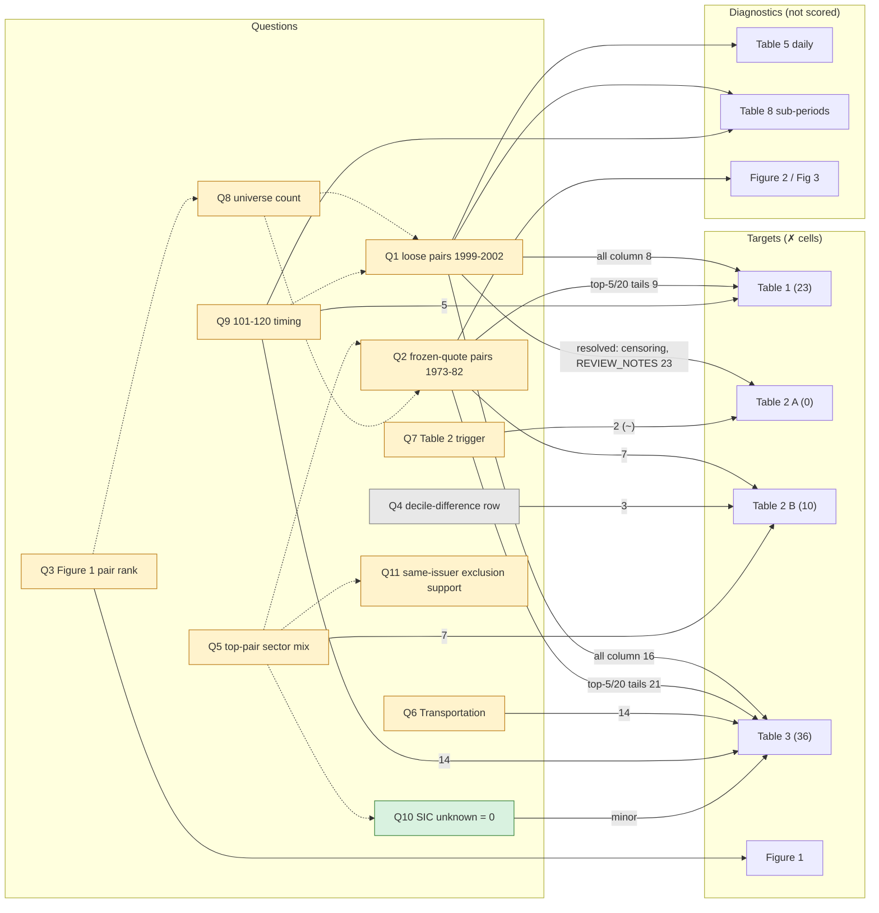

# Open questions: what is still off in the scored cells

The scored set is Tables 1-3, 4, 5 Panel A, 7 and 8 and Figure 4's printed correlations (481
cells; SCORE_LOG row 15), with Figure 1 as a pass/fail check. Figures 2 and 3 are printed through
readings of their images, unscored; Tables 5 Panel B, 6 and 9 are measurements recorded in
`REVIEW_NOTES.md` or below, not printed by the check. The questions below were opened on Tables 1-3
and Figure 1 and still concern those cells. `COVERAGE.md` indexes all thirteen items of
the published paper and says what each is scored for, so the status statement lives there. This file
is the tracker: every unresolved difference gets one question ID, linked to the cells it explains,
the evidence so far, what was ruled out, and the next test. Update it whenever a finding changes a
question; details stay in `REVIEW_NOTES.md` (section numbers below).

Status words: **open** (no explanation), **narrowed** (located, not explained), **parked**
(probably an edition difference), **closed** (settled, kept for the record).

The shipped score and its history are in `SCORE_LOG.md`. The questions below explain the ✗ cells
of that check.

Every table and figure in the published paper, and where this replication stands on
each, is indexed in `COVERAGE.md`.

## Graph

Arrows run from a question to the cells it would explain, labelled with the number of ✗ cells.
Dashed arrows are links between questions.

No question is **open** as of 2026-10-24: Q1, Q2, Q3, Q5, Q6, Q7, Q8, Q9 and Q11 are narrowed
(located, not explained), Q12 narrowed (section 29), Q4 parked, Q10 closed. Each narrowed question names in its
"Next test" cell the one observation that would settle it, and for all of them that observation
is a piece of the paper's own data we do not hold - the 2002 CRSP vintage (Q2, Q3), the authors'
sector and share-type coding (Q5, Q8, Q11), or the late-sample Nasdaq population (Q1, Q9). The
score consequence of that is in "Attainability of 200" below.

## Tracker

| ID | Question | Cells it explains | Status | Next test |
|---|---|---|---|---|
| Q1 | Loosely matched pairs (ranks beyond about 500) are 2.5-4x too volatile in 1999-2002, so every "all" tail is off | Table 1 "all" column 8 ✗; Table 3 "all" columns 15 ✗ (Utilities 2, Transportation 5, Financials 5, Industrials 3). The Table 2 A std-of-time-open ✗ is resolved: censored last-five-cohort windows biased the dispersion rows, fixed by the completed-window reading (REVIEW_NOTES 23, SCORE_LOG row 11) | narrowed; the February 2000 loss is also in a large-cap-only universe (Table 9 A: minimum -6.9% against -2.7%), so it is mechanics or 1999-2000 data, not small-cap noise (cross-checks, round two); section 26 puts the whole gap in 1999-2002: without it the "all" minimum is -2.70% against the paper's -2.72% and the standard deviation 1.62% against 1.67%, while every cohort trading in 2000-02 loses 5-16% on real 22-29x Nasdaq short legs | Find what in the paper's rules or data would damp the short leg of loose pairs in 1999-2000; a -100% loss floor per trade and equal weighting were tried and rejected. Round nine splits it further with the paper's own Table 7 and Table 4: the concentrated portfolios replicate to 0-3% on both books, the whole defect is the "all" portfolio's long book (-7%) plus the dispersion of both books in the loose bands (+8% to +11%), and its factor profile is the mirror image of the paper's (market +0.06 against -0.15), so the loose pairs are a different population rather than a different weighting |
| Q2 | Frozen-quote Nasdaq pairs (1973-82) fill our top ranks and earn almost nothing; the paper's top pairs earn more | Table 1 top-5/top-20 tails 9; Table 3 top-5/top-20 columns 21; Table 2 B top-5/top-20 sector mix; Figure 2 Jan 1975 | narrowed; not closable with the data we hold. The paths are read (evidence below): our top-ranked January 1975 pairs are quote-only Nasdaq names, its top pairs earn 15-25% that month. No threshold separates them without contradicting the paper's own pair count, so the question is which securities the 2002 CRSP carried, as in Q3 | Revisit only with the 2002 CRSP file, or with a paper statement about quote-only stocks; section 26 shows this month carries the small portfolios' skewness. Round 2 of the score goal closed the screen question with WRDS queries. The paper's own count settles it: a screen at 25% frozen days would drop 555 of the 2,626 stocks in the 1974-12 formation universe (21%), taking the pair count to about 1,590 against the paper's 2,057, so their screen cannot have removed our frozen names - their Nasdaq data either carried volume or was not screened. And no CRSP field can replace the missing trade flag: for the frozen and the liquid Nasdaq names alike, `stksecurityinfohist` returns tradingstatusflg 'A', exchangetier 'N/A', securityactiveflg 'Y', conditionaltype 'RW', and a populated nasdcompno, and neither `crsp.dsf` nor `crsp_q_stock` records vol or numtrd for any Nasdaq name in 1974 (the NYSE control has volume on all 128 days of 1974H2 and numtrd null throughout). Round nine closes the tuning route: --max-stale-share 0.99 / 0.95 / 0.90 / 0.85 score 173.0 / 187.0 / 182.0 / 180.5, so the shipped 0.95 is a measured maximum and the tail cells it would win (Table 1 Panel B 101-120 maximum 5.85% -> 8.86%) cost more level cells than they gain |
| Q3 | Kennecott-Uniroyal is the paper's pair 5 in the cohort trading from August 1963 and our pair 4 | Figure 1 rank; every top-5 statistic | Subset not testable with the data we hold (see evidence). Revisit only if the 2002 share-code coding of funds can be found |
| Q4 | What does "average decile difference for mixed pairs" (0.97-0.98 RFS, 1.0 in 1999, flat across portfolios) measure? | Table 2 B 3 | tested, parked. Both editions print the same flat value - 0.97/0.97/0.97/0.98 in the RFS and 1.0 in every column of the 1999 draft's Table II B - and a mean of integer gaps among mixed pairs cannot be below 1, so the row is definitional on their side, not a gap we can close by matching size deciles more tightly. Ours is 1.12 / 1.22 / 1.61 / 2.15 | **Answered in round nine by the paper's own prose**, which says "the stocks in mixed pairs differ on average by a single decile": the row is the mean |decile difference| *among mixed pairs*, and 0.97 means that in the paper almost every mixed pair is exactly one decile apart. Measured on our pairs with the same CRSP deciles the other rows match on: ours average 1.66 / 1.68 / 2.33 / 2.67 apart, with only 50 / 53 / 39 / 33% of mixed pairs adjacent, and recomputing the deciles inside each sector does not help (2.43 / 2.44 / 2.58 / 2.58). The row is therefore a composition fact, not a formula we have not guessed. It also exposed a bug: `composition_stats` computes `avg_decile_diff_mixed_pairs` over *all* pairs, so it prints the same number as `avg_decile_diff_all_pairs` and the check compares an all-pairs mean with a mixed-only target (top 5 would read 1.66, not 1.12, and lose the one cell it scores) |
| Q5 | Top-5 and top-20 sector mix: our top pairs are too purely Utilities/Financials (mixed-sector 0.10 / 0.13 against 0.20 / 0.22; Industrials 0.07 / 0.08 against 0.15 / 0.14) | Table 2 B 7 (Transportation 2, Financials 1, Industrials 2, mixed-sector 2) | the editions disagree on the target itself: the 1999 draft's Table II B has 81% Utilities, 4% Financials and 13% Industrials in the top 5 against the RFS's 72 / 11 / 15, and ours (77 / 14 / 7.5) sits between them on Utilities and Financials but below both on Industrials. Under EDITION_1999.md's rule the RFS is the target and the draft can only veto, so the Industrials shortfall is the part worth chasing; narrowed; no reading of the paper's by-sector rule changes it (section 27: a same-sector subset of the unrestricted pairs scores 157.5 and loses two columns the paper prints). The 495x move of REVIEW_NOTES 24 leaves the top-mix cells untouched (weight_utilities 0.774 in both states) and fixes only the far end of the Utilities ranking; not the sector map, the stale limit, funds or post-1983 data errors (sections above and below); the RFS gap is bigger than the 1999 gap. The unknown-SIC fallback order was reversed and shipped (header SIC first, REVIEW_NOTES 22, SCORE_LOG row 10): it moves eight Table 3 cells but none of the top-mix cells, so the question stands | Find what differs between the RFS and 1999 editions' data; delisting handling and the price-sign day rule remain untried |
| Q6 | Transportation: our top-5, top-20 and "all" means, t-stats and medians are too high (0.93% against 0.50%) | Table 3 Transportation 14 | narrowed; the membership end was tried too: 46xx pipelines out is neutral, 41xx transit out and 47xx services out each lift Transportation by half a cell and cost Industrials a full one (REVIEW_NOTES 24). Section 26: a level gap, not a tail gap -- the standard deviations match (3.93 / 2.93 / 2.96% against 3.89 / 2.94 / 2.87%), the mean is 2x in both sub-periods (1.22% before 1989, 0.48% after) and the ten largest months are only 24% of the total, so it is a selection difference of about two pairs per cohort among roughly 54 | The sector count already matches (61); check pairs and SIC 47xx, then sample noise (about 61 stocks) |
| Q7 | Table 2 trigger: ours 0.041 / 0.047 (0.039 / 0.045 before the RMS trigger) against 0.0476 / 0.0528 | Table 2 A 2 (~ only) | narrowed: sigma as the RMS of the spread about zero gives 0.0409 / 0.0467 and the 1999 draft's 0.0399 / 0.0449 exactly (round six); shipped (REVIEW_NOTES section 21) | Explain the remaining RFS gap (top 5 / top 20 still 14% / 12% low) when the 1999 draft is matched. Round nine rules out a trigger error as the cause of the tail gap: the same portfolios' Table 4 persistence is right for the top 5 and top 20 (0.11 / 0.14 and 0.24 / 0.24) and only the 101-120 band is off (0.07 / 0.19), so the depth of the trigger and the shape of the returns disagree in one band rather than everywhere |
| Q8 | Universe size: ours 2,009 pairs against 2,057 (-4% before 1997, +5% after), Financials 349 against 371 | Indirect: Q1, Q2, Q3 | narrowed: adding shares of beneficial interest (REITs, trusts) gives 2,034 pairs and Financials 376 but scores 168.5 and leaves the era split (round five) | Explain the era split; decide whether the share filter should take beneficial-interest shares |
| Q9 | 101-120 level is right over the full sample but the pre/post-1988 split is off (post-1988 0.59% / 1.37% against 0.33% / 1.12%) | Table 1 101-120 5; Table 3 101-120 14 | narrowed: the same post-1988 cluster as Q1, not a separate rule - the level and the dispersion are both about 1.7x the paper's (0.59% / 1.37% against 0.33% / 1.12%) and pre-1989 the same portfolio matches (0.94% / 1.52% against 1.05% / 1.53%, cross-checks round two). Section 26.9 puts the whole gap in the ranks past 120 after 1988, which Q9 shares | Nothing separate: close it with Q1. Round nine adds the band's signature: its level and dispersion match, its persistence is a third of the paper's (0.07 against 0.19) and its correlation with the top 20 is 0.39 before 1989 against the paper's 0.51, so the band holds different stocks rather than the paper's stocks with a different weight |
| Q10 | SIC 0 (unknown) is mapped to Industrials | Table 3 counts | closed | None |
| Q11 | Is the same-issuer exclusion supported by anything but returns and the trigger? Composition says it costs about 1.5 of 20 cells in both editions | Table 2 B top-5/top-20 Industrials and mixed-sector (3 to 4 cells); indirectly every top-5 statistic | narrowed: supported by the trigger and the round-trip spread, opposed only by composition; kept | Revisit only if a new reading of Q5 changes the composition target |
| Q12 | The paper's Table 5 B daily "all" column (sd 0.169%, 1% -0.33%, minimum -1.07%) is about 0.7x ours in every quantile and inconsistent with its own monthly "all" (monthly mean / daily mean 26.5 against 22.5 for the others) | Not a Table 1-3 cell; it would explain how the paper built "all" | narrowed: weighting each short position by its own compounded return (eq. 3 read on the position, REVIEW_NOTES 29) gives sd 0.191%, 1% -0.40%, minimum -1.47% and mean 0.029% (paper 0.027%), about two-thirds of the gap in every quantile and before 1999 too | What is left is the "all" long book, 7% low and 10% too volatile in Table 7 (Q1). Round nine replicates the whole Table 7 top block on the shipped reading, so this is no longer guesswork: long 1.245 / 1.359 / 1.482 / 1.507 against 1.245 / 1.330 / 1.458 / 1.623 and short 0.522 / 0.467 / 0.717 / 0.878 against 0.501 / 0.435 / 0.663 / 0.908 - within 9% everywhere, so the short book is no longer the gap |

Closed or rejected in the same period, kept so they are not repeated: the fully-invested denominator
(open-pair-days reading, confirmed by the daily panel, section 19.2); close-date cash-flow booking
(Table 3 27-28 of 135; section 17); the stale-share limit as a fix (section 19.5); alternative eq.
(3) weights, desk weighting, SIC-source sweeps (section 15).

## How the questions connect

Testing questions one at a time kept returning "no single knob". Putting the measurements side by
side (every 3rd cohort, 1963-2002, 79 cohorts) shows two clusters and one shared signature.

**Signature: the missing top pairs are large-cap, cross-sector and mostly post-1983.** Ours against
the paper, top 5 (the paper's numbers are whole-sample averages):

| | mixed-sector | Utilities | Industrials | avg size decile |
|---|---|---|---|---|
| paper | 0.20 | 0.72 | 0.15 | 2.54 |
| ours, 1963-82 | 0.16 | 0.74 | 0.11 | 2.92 |
| ours, 1983-88 | 0.03 | 0.95 | 0.01 | 2.08 |
| ours, 1989-2002 | 0.03 | 0.81 | 0.04 | 2.58 |

Before 1983 our top pairs look like the paper's. After 1983 they are almost all same-sector
Utilities pairs (95% Utilities in 1983-88), which the paper's whole-sample 0.72 cannot allow.

**Two knobs tried against all the dots at once** (whole sample, top 5 unless stated):

| variant | stocks | pairs | Financials stocks | mixed | Utilities | Industrials | decile | KU rank 1963 |
|---|---|---|---|---|---|---|---|---|
| paper | 2,317 | 2,057 | 371 | 0.20 | 0.72 | 0.15 | 2.54 | 5 |
| ours (stale 0.95) | 2,275 | 1,991 | 347 | 0.10 | 0.80 | 0.07 | 2.68 | 4 |
| no stale limit | n/a | 1,998 | n/a | 0.16 | 0.71 | 0.10 | 3.30 | n/a |
| stale 0.50 | n/a | 1,713 | n/a | 0.07 | 0.86 | 0.06 | 2.28 | n/a |
| + equity-like funds (beta > 0.7) | 2,296 | 2,011 | 367 | 0.10 | 0.78 | 0.07 | 2.73 | 4 |
| + equity-like funds (beta > 0.3) | 2,319 | 2,033 | 391 | 0.11 | 0.67 | 0.06 | 3.02 | 5 |
| + all closed-end funds | 2,358 | 2,068 | 429 | 0.09 | 0.46 | 0.06 | 3.62 | 5 |

Readings:
- **Stale limit trades sector mix against size.** Dropping it lifts mixed-sector and Industrials
  toward the paper but pushes the size decile to 3.30 (paper 2.54). So the missing pairs are not
  small stale-quote names.
- **Funds close the counts, not the mix.** Equity-like funds (beta above 0.7) bring stocks to 2,296,
  Financials to 367 (paper 371) and pairs to 2,011, but leave mixed-sector at 0.10 and raise the
  Financials weight of the top pairs, the wrong way (paper 0.11). So funds are a candidate for Q8
  only. The beta rule is a diagnostic proxy, not a convention we can defend.
- **Pair-ranking variants are scattered.** Of eight criteria on the 1963 cohort, only an additive
  (non-compounded) index gives rank 5, which is one hit in eight and not principled.

**Clusters**
- **Cluster A, pre-1983 (universe at the margin):** Q2 Jan 1975, Q3 Figure 1 rank, Q8 pair count
  (ours -4% before 1997). Tied together by which marginal securities (frozen quotes, closed-end funds)
  the paper's CRSP carried.
- **Cluster B, post-1983 (top-pair composition and the late-sample tails):** Q5 sector purity, Q9
  101-120 timing, Q1 loose pairs 1999-2002, Table 8 post-1988 and Figure 3 for 1989-93 (paper 0.25
  against ours 0.63 %/month). Pre-1989 returns match the paper in all four portfolios, so the break
  is in the data or rule after the mid-1980s, not in the engine. Ours has +5% pairs after 1997, the
  opposite sign of cluster A.

**Implication.** Q5 should be worked as a post-1983 question. The next test that follows from this:
rank the top-5 pairs of a post-1983 cohort (for example 1985-07, 1990-07) and find what the paper's
mix (about 30% non-Utilities weight in the top pairs) would need to be there. Candidates not yet
tried: different "no trade" day rule after Nasdaq volume starts (price sign against volume), and
the delisting and merger handling after 1983.

## Why keep the stale-quote filter (logic, not score)

A match score cannot justify a convention: the 164.0 baseline hid two offsetting errors, and a rule that
raises a capped score may be wrong. The filter (drop a stock whose price is unchanged with no recorded
volume on more than 95% of the formation days) is kept only if it makes predictions about the paper that
do not depend on the score. Measured every 3rd cohort, stale limit none / 0.99 / 0.95 / 0.90 / 0.75 / 0.50:

| observable (paper) | none | 0.99 | 0.95 | 0.90 | 0.75 | 0.50 | reading |
|---|---|---|---|---|---|---|---|
| pairs, RFS sample (2,057) | 1,998 | 1,998 | 1,991 | 1,971 | 1,868 | 1,713 | rules out 0.75 and 0.50; 0.95 costs 0.3% |
| pairs, 1999 sample (1,870) | 1,793 | 1,792 | 1,784 | 1,761 | 1,643 | 1,465 | same |
| top-5 trigger, 1999 (0.0399) | 0.0361 | 0.0366 | 0.0386 | 0.0390 | 0.0393 | 0.0393 | none is 10% low, 0.95 is 3% low |
| top-5 trigger, RFS (0.0476) | 0.0372 | 0.0377 | 0.0394 | 0.0398 | 0.0400 | 0.0400 | no setting closes it (-17%); neutral |
| top-20 size decile, RFS (2.71) | 3.07 | n/a | 2.73 | n/a | 2.48 | 2.42 | 0.95 is within 1%; none is 13% off |

What this supports. Only the near-frozen tail matters: going from none to 0.99 or 0.95 changes the pair
count by 0.3% but removes tiny-spread, small-cap pairs from the top ranks, which is what the 1999
trigger and the RFS size decile of the top 20 both respond to. The pair count cannot support a stricter
limit than 0.95 to 0.90. The mechanism ("a price that never moves and has no volume is not evidence of a
trade") is the only reading of the paper's "no trade" rule that fits its stock counts, since the paper
keeps more stocks than ours at every setting and so cannot have dropped quote-only Nasdaq names wholesale.

What it does not support. The threshold is not pinned: 0.90 to 0.99 are indistinguishable on pairs
(1.4%) and differ by 5% on the top-5 trigger. The RFS top-5 trigger is neutral. If a later finding
explains the post-1983 cluster (section above) differently, re-run the on/off comparison.

## Post-1983 test of Q5 (what the top pairs are, and what the editions say)

**1. The top pairs are what they should be.** Top-20 pairs of three post-1983 cohorts (names from
CRSP, sectors as shipped):

| cohort | utility pairs | industrial pairs | financial pairs | cross-sector | first cross-sector rank (distance; rank-20 distance) |
|---|---|---|---|---|---|
| 1985-07 | 16 | 2 | 0 | 2 | 8 and 19 |
| 1990-07 | 20 | 0 | 0 | 0 | 35 (0.124; 0.084) |
| 1995-07 | 13 | 2 | 1 | 4 | 11 |

The 1985 cross-sector pairs are regional Bell holding companies that CRSP codes as Financials
(BellSouth, Bell Atlantic) against AT&T and a power company. In 1990 no ranking variant can bring a
cross-sector or industrial pair into the top 20, because the next ones sit at 0.124 and 0.219 against
0.084. So the missing mix would need different pairs, not a different ordering.

**2. The sector map is not the cause.** Four maps on all 78 cohorts, top 20 (paper 0.71 / 0.14 / mixed
0.22) and stocks per sector (paper 156 / 61 / 371 / 1,729, an observable that does not depend on the
score):

| map | top-20 Utilities | Industrials | mixed | Utilities stocks | Industrials stocks |
|---|---|---|---|---|---|
| as shipped then (49xx and telephone 481x) | 0.793 | 0.074 | 0.129 | 161 | 1,704 |
| no telephone (4900-4999) | 0.751 | 0.116 | 0.164 | 136 | 1,729 |
| all 48xx and 49xx | 0.793 | 0.074 | 0.129 | 186 | 1,679 |
| electric, gas, water only (4900-4949) | 0.751 | 0.116 | 0.164 | 129 | 1,736 |

Taking telephone out of Utilities moves the top-20 mix toward the paper but cuts the Utilities count
13% below the paper's 156, while the map shipped then was 3% above it. The count is the independent
check, so that map stayed. The "all" column agrees with the paper under it (Utilities 0.091 against
0.08, Financials 0.148 against 0.16, Industrials 0.731 against 0.73).

Since this was measured the map moved twice: telephone narrowed from 481x to 4811 (row 8) and waste
management (495x) went to Industrials (row 12). The shipped counts are now Utilities 137,
Transportation 61, Financials 347, Industrials 1,750 against the paper's 156 / 61 / 371 / 1,729, so
Utilities is 12% **below** the paper rather than 3% above — the one number in this section that the
sector rulings changed (see the Table 3 stock-count row of `REPLICATION_CHECK.md`).

**3. Ours reproduces the 1999 draft, not the RFS.** On the 1999 window (68 cohorts, July 1963 to
January 1997) against the 1999 draft's Table II:

| top-20 | trigger | Utilities | Financials | Industrials | mixed-sector |
|---|---|---|---|---|---|
| 1999 draft | 0.0449 | 0.82 | 0.04 | 0.13 | 0.17 |
| ours, same window | 0.0437 | 0.84 | 0.07 | 0.08 | 0.13 |
| RFS | 0.0528 | 0.71 | 0.13 | 0.14 | 0.22 |
| ours, full 78 cohorts | 0.0446 | 0.79 | 0.12 | 0.07 | 0.13 |

All four trigger columns are within 3% of the 1999 draft on its window (top 5 0.0391 against 0.0399;
all 0.1566 against 0.1518). The remaining gap is Industrials and cross-sector pairs, about 5 points
each, and it is the same in both editions.

**4. The editions differ in more than an added tail.** The formation text is word for word the same in
both (section 2.1 of the RFS and section III.1 of the draft). If the first 68 cohorts were identical,
the 10 added cohorts (1997-2002) would have to carry the whole shift: top-20 Utilities about 0%,
Financials about 74%, mixed-sector about 56%, top-5 trigger about 0.10. Ours has 48%, 48%, 14% and 0.043
there. Utilities cannot be negative, so the earlier cohorts differ too. The size decile agrees:
1999 draft 3.1 / 3.2 / 4.0 / 5.8, RFS 2.54 / 2.71 / 3.41 / 4.57, ours on the 1999 window 2.59 / 2.59 /
3.06 / 4.54, ours full 2.68 / 2.73 / 3.2 / 4.6. We match the RFS decile on the full sample and not the
draft's on its own window, so the editions do not measure size the same way either.

**5. A pattern in the trigger.** Paper minus ours in the variance of the 2σ trigger (σ squared) is
1.7 / 2.0 / 2.4 / 2.1 (x 10^-4) for top 5 / top 20 / 101-120 / all: nearly constant, which suggests a
common additive noise of about 1.4% in the paper's spread (not a scale factor, whose ratio falls from
1.20 to 1.02). A constant shift adds the same amount to every pair's distance and leaves the ranking
alone, so it would not change the composition. It may belong to Q7 only. Not tested further.

**6. The two exclusions against both editions (new second scorer, PR #20).** Each shipped exclusion
(same-issuer pairs out, near-frozen quotes out) scored on every observable that does not come from the
return tables. Top 5 and top 20 together, 10 composition statistics each (20 cells per edition):

| variant | RFS composition | 1999 composition | top-5 trigger, 1999 window (draft 0.0399) | top-5 trigger, full (RFS 0.0476) |
|---|---|---|---|---|
| neither | 9.0 | 11.0 | 0.0348 | 0.0337 |
| same-issuer exclusion only | 9.0 | 11.0 | 0.0364 | 0.0375 |
| stale screen only | 13.0 | 9.5 | 0.0370 | 0.0356 |
| both (shipped) | 11.5 | 8.0 | 0.0390 | 0.0397 |

Readings:
- **Trigger favours both exclusions** in each edition, and the 1999 window is reproduced within 2%
  with both on. This is the one observable that does not depend on the return tables, and it is the
  independent support for the shipped pair.
- **Composition is split.** The stale screen helps the RFS (+4) and hurts the 1999 draft (-1.5); the
  same-issuer exclusion costs about 1.5 cells in both editions. Neither edition mentions same-company
  pairs, so the paper gives no text to settle it.
- **The 1999 draft also wants more Industrials and cross-sector pairs than the shipped pair gives**
  (top-20 Industrials 0.127 without the exclusions against 0.081 with them, draft 0.13). The RFS wants
  the same thing from the other side: its top-20 Industrials of 0.14 is matched without exclusions
  (0.146) and missed with them (0.078).
- **So Q5 is partly what the same-issuer exclusion removes.** Dropping those pairs lifts the trigger
  and the returns and lowers top-20 Industrials from 0.146 to 0.095 (RFS 0.14). Whether the paper's
  data contained them is not decided by anything we hold: see Q11.

**What this settles for Q5.** The gap is not a ranking, sector-map, stale-limit or fund effect. It is
absent from the 1999 edition's pair characteristics and present in the RFS ones, so it is specific to
what the RFS computed. Untried: delisting and merger handling after 1983, the price-sign day rule, and
whether the RFS used a different CRSP vintage for 1997-2002.

## Attempt at 180 (2026-10-21): where the remaining points are

The shipped check then scored 169.5. Reaching 180 needed 10.5 more points. A search for a principled change
that gets there found none. What was measured:

**1. Where the failures are.** Across Tables 1 and 3, by statistic (✓ / ~ / ✗):

| statistic | ✓ | ~ | ✗ |
|---|---|---|---|
| skewness | 1 | 2 | **20** |
| kurtosis | 2 | 9 | 12 |
| minimum | 7 | 4 | 12 |
| median | 8 | 5 | 10 |
| maximum | 5 | 10 | 8 |
| mean | 16 | 10 | 5 |
| t-statistic | 10 | 9 | 4 |
| standard deviation | 17 | 5 | 1 |

Location and spread are matched. The failures are the shape of the monthly distribution: ours is less
right-skewed than the paper's in every portfolio and sector (Table 1 "all", one-day wait: 1.02 against
3.32; top 20: 0.19 against 1.45), and its median sits above the paper's while the means agree.

**2. Skewness does not respond to any knob we hold.** Skewness cells matching across 50 cache variants
(universes, stale limits 0.20 to 0.999, with and without the same-issuer exclusion, delisting fills,
value-weighted and count books, open-day and zero-day rules): at most 5 of 23, and 1 of 23 for the
shipped pair. The best variants score 140 or less overall.

**3. The dot-com months are real but cap out low.** Without 1999-2002 our "all" series has minimum
-3.05% (paper -2.95%) and skew 1.95. Neutralising December 1999, February 2000 and September 2000
(oracle: replace by the sample median) adds 0.5 points to Table 1 panel A and 2.0 to panel B, so a
perfect fix of those months is worth about 2.5 points in Table 1 and perhaps 4 more in Table 3. The
loss is broad (92% of it from pairs with a formation sigma of 0.05 to 0.3, almost all Nasdaq short legs).

**4. Factor loadings (Table 4 check).** Our "all" book on the Fama-French factors, momentum and the
French short-term reversal factor: momentum -0.25 (paper -0.18), reversal 0.24 (0.20), market +0.05
(-0.15), R-squared 0.66 (0.54). Same signs and similar size, so the exposure is not a sizing error.
February 2000 has a residual of -4.7% after the factors; December 1999 has none. The paper's pre-1989
Table 8 loadings are on a different scale from its Table 4 (its reversal factor has a 7% standard
deviation, French's has about 3%) and cannot be compared.

**5. Buy-and-hold legs (rejected).** Eq. 2-3 say the daily returns on the long and short positions are
compounded to monthly. Compounding each book separately and differencing (instead of compounding the
daily difference) scores 166.0: Table 1 unchanged (+1), Table 3 worse (60 ✗ against 51), and the "all"
skew falls from 1.02 to 0.68. Not adopted.

**Reading.** The remaining gap is a distribution-shape gap (skew, kurtosis, tails, median) that is
shared by every portfolio and sector and survives every universe, exclusion and booking rule tried.
That points to something in how the paper built or averaged its monthly series, or to a data-vintage
effect, rather than to a missing trading rule. No change was shipped. The maximum identifiable
payoff from the dot-com months alone (about 6 points) would not reach 180.

## Cross-checks, round two (2026-10-21): what the paper's other numbers say about the monthly series

Nothing here changes the check that was shipped then (169.5). Each check uses a number the paper reports that is not
a Table 1-3 cell, or a Table 1-3 number read another way, and asks whether our series is the same
object. Experiments are in the scratch area, not in the repo.

**Verdict: the engine reproduces the paper's series almost exactly where the portfolio is small or the
period is before 1989; what differs is concentrated in three places (loose pairs after 1988,
January 1975, the dot-com months).**

| check (paper number) | result, ours / paper | reading |
|---|---|---|
| Table 5 B daily VaR, top 5 / top 20 / 101-120 (9,942 daily series, one-day wait) | daily sd 0.495 / 0.302 / 0.290% against 0.492 / 0.296 / 0.277%; 1% quantile -1.18 / -0.64 / -0.65% against -1.24 / -0.65 / -0.65%; 5%, 10%, 25% quantiles within 5%; serial correlation -0.10 / -0.06 / 0.05 against -0.12 / -0.06 / 0.00; minimum -10.0 / -5.9 / -1.9% against -10.1 / -6.7 / -2.0% | the daily fully-invested construction (eq. 2-3, open-pair-days) is right for the three small portfolios |
| Table 5 B daily VaR, "all" | daily sd 0.243% against 0.169% (x1.44); 1% -0.51 against -0.33%; 5% -0.29 against -0.20%; 25% -0.090 against -0.071%; minimum -2.06 against -1.07%; serial correlation 0.347 against 0.35. Pre-1999 our sd is still 0.212%. Equal-weighting the open pairs instead of value-weighting leaves it at 0.237% | the paper's "all" daily column is about 0.7x ours in every quantile, so a scale and not a tail. Its own monthly mean over its daily mean is 26.5 for "all" and 22.4-22.7 for the other three (ours 20-21 for all four), so the column is not the same object as its Table 1 series (Q12) |
| Figure 2, top-20 monthly bars (digitized from the embedded 640 px image, 564 pixel columns; x axis is July 1963 - December 2002, not May 1963 as the caption says) | position of ours against the bars peaks at zero shift (correlation of the positive extents 0.68, negative 0.76; it falls at one-pixel offsets). 10 of the 18 bars above 3.4% match ours within 15% in the same month. The big negatives match (April 1974 -8.3 against -8.9; November 1983 -3.5 against -2.9). Mean bar height before 1989 2.14 against 2.07, after 1988 1.09 against 1.08 | the series is the same month by month. Misses: January 1975 +13.6 against +3.6; August/September 1974 7.6 against 5.2; January 1976 5.0 against 2.6; March 1980 6.2 against 4.3; September 1998 5.6 against 2.6; April 1987 3.5 against 2.5; December 2001 3.4 against 2.5 |
| Table 8, pre-1989 (all four portfolios, one-day wait) | mean / sd: top 5 1.01 / 2.31 against 1.03 / 2.26; top 20 1.26 / 1.64 against 1.18 / 1.69; 101-120 0.94 / 1.52 against 1.05 / 1.53; all 1.00 / 1.53 against 0.99 / 1.65 | matched for all four |
| Table 8, post-1988 | top 5 0.30 / 1.45 against 0.22 / 1.66; top 20 0.43 / 0.99 against 0.38 / 0.99; 101-120 0.59 / 1.37 against 0.33 / 1.12; all 0.40 / 2.33 against 0.21 / 1.30. The paper's pre and post figures weight back to its own full-sample "all" mean and sd (0.715%, 1.58%), so the paper is internally consistent here | the post-1988 loose portfolios are about 2x too profitable and too volatile in ours; the committed basis does not fit them either (0.18 / 1.52) (Q1, Q9) |
| Table 9 A (pairs from the top three size deciles only, one-day wait; a clean universe, no quote-only or thin stocks) | mean 0.98 / 1.03 / 0.74 / 0.75% against 0.84 / 0.91 / 0.73 / 0.69%; sd 2.15 / 1.63 / 1.58 / 1.49% against 1.90 / 1.46 / 1.58 / 1.29%; max 9.5 / 9.5 / 7.6 / 8.6% against 10.1 / 10.0 / 10.6 / 10.5%; minimum -14.6 / -9.6 / -4.7 / -6.9% against -10.9 / -5.6 / -3.8 / -2.7%; skew -0.13 / 0.16 / 0.42 / 0.95 against 0.02 / 0.98 / 0.80 / 1.77 (the paper's Table 9 labels its skewness and kurtosis rows the wrong way round) | the body matches in a large-cap universe too; the dot-com loss does not go away: the "all" minimum is February 2000 (-6.9%) against a paper minimum of -2.7% in 40 years. So the dot-com gap is trading mechanics or data in 1999-2000, not small-cap noise (Q1) |
| Cohort 1999-09 in that large-cap universe | 834 pairs, 1,370 trades, net payoff -97; 50 trades lose more than the $1 committed (worst -7.5) and the part of losses beyond -$1 is -64 of the -97 | a buy-and-hold short that multiplies is the whole loss; a floor at -100% per trade was tested (below) |
| Table 7 long and short books (value-weighted, one-day wait) | top 5 / top 20 / 101-120: means 1.27 / 1.36 / 1.48% long and 0.48 / 0.39 / 0.65% short against 1.25 / 1.33 / 1.46 and 0.50 / 0.44 / 0.66; sd within 0-12%; serial correlation within 0.02 (a close match). "all": long 1.50, short 0.70, sd 5.67 / 5.14 against 1.62, 0.91, 5.16 / 4.60; equal-weighted 1.79, 0.78, sd 5.81 / 5.05 | the paper's "all" legs are less volatile and earn more than ours under either weighting |
| Table 2 A std rows over cohorts with a full six-month window (formed through July 2002, 469 cohorts) instead of all 474 | std of time open: top 5 0.70, top 20 0.45, 101-120 0.36, all 0.20 against 0.80, 0.45, 0.38, 0.17 (all cohorts: 0.73, 0.50, 0.44, 0.31); std of round trips for "all" 0.160 against 0.16 | the late truncated cohorts (August-December 2002) explain the "all" std-of-time-open miss; the paper's caption says 474 months, so this stays a sensitivity (the 165.5 reading of 2026-10-20) |
| No-wait over one-day-wait mean (bid-ask bounce) | "all" 1.33 (median ratio 1.40) against 1.54 (1.77); top 5 1.77 against 1.76; top 20 1.52 against 1.60; 101-120 1.27 against 1.36. `price_common` gives "all" 1.52 / 1.79 | the paper's "all" book is more bounce-prone than ours; its no-wait series has only 17% negative months against our 24% |

**Tests of changes suggested by these checks (all rejected, none shipped).**

- *Floor each trade's loss at the $1 committed* (a trade closes when its cumulative payoff reaches -1;
  limited liability). "All" skew 1.02 → 1.79, minimum -12.3 → -5.8%, sd 1.87 → 1.70% (paper 3.32,
  -2.95%, 1.58%), but Table 3 loses cells and the score falls 2.5 points (169.0 → 166.5 on the
  scratch scorer). The minimum is still twice the paper's.
- *Equal-weight the daily returns of the open pairs* (no snowballing of exploded shorts). "All" skew
  1.71, minimum -8.8%, mean 0.98% (paper 0.72%); top 5 and top 20 skew get worse; score 158.5.
  The daily "all" column does not move (0.237% against 0.169%), so weighting is not what separates it.
- *Stricter stale-quote limit with the same-issuer exclusion on*: limit 0.5 / 0.6 / 0.7 / 0.8 / 0.9 /
  0.95 scores 140.0 / 142.5 / 144.5 / 148.5 / 159.0 / 169.0. Without the exclusion a 0.5 limit makes the
  top-5, top-20 and 101-120 skews match the paper in both panels (0.69 / 1.41 / 1.49 against
  0.62 / 1.39 / 1.34 no wait) and lifts January 1975 from 5.2 to 10.6%, but it takes the Financials
  count to 264 (paper 371), and with the exclusion on the score to 140: the shape is carried by a handful
  of half-stale stocks, not by universe size.

**New observations worth a follow-up.**

1. The paper's Figure 3 fully invested curve ends at 39.7 on its calibrated log scale, but
   compounding its own Table 1 B top-20 mean from the figure's first read month gives 72.5 (ours
   72.1), so that curve is not the compounded fully-invested series. The committed curve is: 11.5
   on the figure, 11.5 from Table 1 B, 11.6 ours (REVIEW_NOTES 42).
2. January 1975 is the one month where all of Figure 2's disagreement sits for the top 20 (a 10-point
   gap); the paper's no-wait maxima are similar across portfolios (14.7, 13.3, 12.7, 17.2%); if they are the
   same month, a month in which every portfolio gains 13-17% regardless of size looks like a data event,
   not a trading rule (the months are not reported, so this is not checked).
3. In our data the January 1975 top-20 pairs are NYSE electric utilities (SIC 4911; permnos 24985,
   25072, 24352) plus Nasdaq financials (SIC 6711, 6311, 6025); the best pairs net 0.15-0.35 of the $1
   in the month.

## Cross-checks, round three (2026-10-21): Nasdaq after 1985

Iterating the open questions turned up one lever that moves the score and several gaps at once. Nothing
is shipped: it has no basis in the paper's text and the paper's stock counts argue against it.

**Test.** Restrict the formation universe to NYSE and AMEX stocks for formation windows ending on or
after a cut-off date (Nasdaq stays in before it). Scores on the scratch scorer (shipped 169.0):

| cut-off | 1975 | 1980 | Jul 1983 | 1985 | 1989 | 1993 | 1997 | never (all years out) |
|---|---|---|---|---|---|---|---|---|
| score | 145.5 | 157.5 | 170.5 | **174.0** | 172.5 | 172.0 | 169.0 | 143.0 |

Dropping Nasdaq in the 1970s costs a lot, dropping it from about 1985 gains 3-5 points, and dropping it
only for the dot-com years gains nothing.

**What moves (cut-off 1985).**
- Table 3 gains most: Utilities 13 ✗ → 6, Transportation 14 → 8, Financials 14 → 13 (✓ 9 → 17),
  Industrials worsens (11 ✗ → 18). Q6 Transportation is partly a Nasdaq-after-1985 effect.
- Table 1 one-day-wait "all": sd 1.58% (paper 1.58%), mean 0.77% (0.71%), minimum -5.3% (-2.95%),
  skew 1.62 (3.32). Table 8 post-1988 "all" 0.38 / 1.59 against 0.21 / 1.30 (shipped 0.40 / 2.33);
  101-120 0.56 / 1.31 against 0.33 / 1.12 (shipped 0.59 / 1.37).
- The February 2000 loss in cohort 1999-09 is entirely Nasdaq short legs (-1,047 against a net -991;
  NYSE shorts +79). Pairs with a NYSE long and a Nasdaq short lose -635 on 1,156 trades; the reverse
  (Nasdaq long, NYSE short) gains +84. Size deciles 8-10 carry -722 of the loss. No other attribute
  separates them (share type, issuer type, US-incorporated, trading status).

**Why it is not shipped.**
- The paper says nothing about exchanges (neither edition mentions NYSE, AMEX or Nasdaq).
- Sector counts fall to 141 / 47.7 / 280 / 1,230 (paper 156 / 61 / 371 / 1,729), where the shipped
  universe matches (161 / 61 / 349 / 1,720). Table 2 Panel B ✓ 28 → 25 and Table 2 Panel A ✓ 15 → 13.
- Screens that mimic it without naming an exchange fail: size-decile floors (drop deciles 9-10 /
  8-10 / 7-10, all years 166.5 / 161.0, Nasdaq after 1985 only 170.0 / 169.0 / 166.5); price-sign day
  rule after 1985 168.0; Nasdaq stocks needing a trade price every day 143.0; needing positive volume
  every day 138.5.

**Reading.** The paper's universe has about the same size as ours on average but looks calmer after
1985, so it probably holds the same stocks in different proportions by era (more marginal pre-1983
securities, fewer or tamer Nasdaq stocks later). That fits the Q8 era split (ours -4% before 1997,
+5% after) and cluster B. A rule that is looser before 1983 and tighter after 1985 for Nasdaq is the
thing to find; the day rules above are not it.

**Also checked.** The paper's Figure 2 and 3 first month is positive (+3 to +4.5%) while ours is
-3.2% (July 1963, one cohort). Rebasing trading prices to 1 on the first day gives +4.6%, but
Figure 1's day-0 levels (1.10) require continued normalization and the full run scores 126.5, so it is
a coincidence of one month. The digitized Figure 3 increments correlate only 0.22 with our series
overall, so they are not usable month by month.

## Cross-checks, round four (2026-10-21): methodology re-read and a data-vintage test

**Re-read.** Both PDFs at the repository root are the 2006 paper: the Yale ICF working paper of
February 2006 (47 pages) and the typeset RFS article (31 pages). Every table value agrees between them.
Only the NBER draft (w7032, March 1999, `report/replication/reference/`) is a different edition. Each
explicit statement in the methodology (formation and trading periods, the no-trade screen, normalized
total-return index, nearest-partner pairing, the 2σ trigger, closing at the next crossing, delisting,
eq. 2-3, committed against employed capital, the wait-one-day rule) matches the code. The Table 1, 2
and 3 targets in `scripts/03_replicate.py` agree with the PDF cell by cell (checked by eye). The text
is silent on securities and exchanges, on what "no trade" means in CRSP, and on where the eq. (3)
weights start; each of these has an entry above.

**Data-vintage test.** If the paper's calmer post-1985 Nasdaq came from different returns in the 2002
CRSP file, the current CIZ daily file would differ from the legacy `crsp.dsf` (the SIZ file). Compared
row by row on 1986, 1991, 1996 and 2000 (7.8 million rows):

| year | rows in both | returns differing by more than 1e-6 | by more than 1e-3 | volume differing |
|---|---|---|---|---|
| 1986 | 1,667,667 | 0.0005% (Nasdaq) | 0 | 0 |
| 1991 | 1,721,774 | 0.0014% | 0 | 0 |
| 1996 | 2,246,600 | 0.0013% | 0 | 0 |
| 2000 | 2,134,099 | 0.18% (Nasdaq), 0.21% (AMEX) | 1 row | 0 |

CIZ has 500-1,000 extra rows a year, all delisting-day rows (`tradingstatusflg = 'D'`). The 5-6% of
Nasdaq rows whose price differs in 1986 and 1991 are bid/ask-quoted days where the legacy file rounds
to five decimals (-0.39063 against 0.390625); returns on those rows agree. The 2000 differences are
below 1e-3 apart from one NYSE row.

**Reading.** Return vintage is closed: the CIZ and legacy files carry the same daily returns, prices
and volumes, so the post-1988 gap is not a different CRSP release. That leaves what the paper
selected, which neither edition describes (round three).

## Cross-checks, round five (2026-10-22): share types, monthly weights and January 1975

Second attempt at 180. Nothing is shipped; the check stayed at 169.5. Every run rebuilds
all 474 cohorts (about 50 seconds with 16 workers). "Error" is a smooth measure used beside the
score: the sum over cells of min(|ours / paper - 1|, 1), lower is better (shipped 64.0). It shows
the direction of a change when the score only moves by cells crossing the 10% and 25% lines.

| variant | score | error | stocks / pairs / Financials per cohort (paper 2,317 / 2,057 / 371) | reading |
|---|---|---|---|---|
| shipped | 169.5 | 64.0 | 2,275 / 2,009 / 349 | |
| + shares of beneficial interest (CIZ `EQTY/COM/SB`: REITs and business trusts) | 168.5 | 62.9 | **2,321 / 2,034 / 376** | counts match; see Q8 below |
| + ADRs (`EQTY/COM/AD`) | 170.5 | 63.8 | 2,352 / 2,060 / 357 | Industrials 1,770 (paper 1,729) |
| + both | 166.5 | 63.8 | 2,380 / 2,086 / 384 | |
| + beneficial interest and `UG` | 165.0 | 64.8 | 2,340 / 2,051 / 383 | |
| foreign-incorporated common dropped | 166.5 | 67.0 | 2,220 / 1,944 / 344 | |
| eq. (3) weights restart each calendar month | 168.0 | 64.4 | unchanged | see below |
| beneficial interest + monthly restart | 167.5 | 63.3 | 2,321 / 2,034 / 376 | |
| formation index from price-only returns (diagnostic) | 164.0 | 67.2 | unchanged | top-5 trigger 0.0395, unchanged: dividend noise is not Q7 |
| stale-quote screen off | 163.5 | 66.9 | | January 1975 "all" unchanged (11.3%) |
| Nasdaq out of windows ending before November 1982 (diagnostic) | 142.0 | 74.8 | 1,875 / 1,632 / n/a | January 1975 top 5 / top 20 rise to 7.2 / 7.5%, "all" falls to 10.3% |
| cohort months with no open position count as 0 | 169.0 | | unchanged | |

**The score is noisy at this level.** Universe changes that move the counts by 1-3% swing the score
by 2 to 4 points in either direction while the error moves by about 1. A 10.5-point gain needs a
mechanism, not a universe tweak.

**Q8, the share filter.** The shipped universe keeps `EQTY/COM/NS` (share codes 10, 11, 12 and
NS-coded REITs). The paper screens "all stocks from the CRSP daily files" and names no share code.
Adding shares of beneficial interest (share code 4x in the legacy coding: 101 REITs, 18 trusts and 7
companies in 1975) brings the stock count within 0.2% of the paper's, Financials within 1.3% and
pairs within 1.1%, and it lowers the error on Table 1 (both panels) and Table 3 Financials. It does
not fix the era split: pairs rise in both eras (July 1963 to June 1997: 1,788 to 1,811 against the
1999 draft's 1,870; July 1997 onwards: 3,377 to 3,414 against the implied 3,213). The score falls
1.0 (Table 3 Industrials t-statistics and means cross the 25% line, Table 2 B Financials weights of
top 20 and 101-120 cross 10%). Candidate for Q8; not shipped, because the score does not support it
and the era split is not explained.

**Eq. (3) read as within-month buy and hold.** The paper says the daily returns are "compounded to
obtain monthly returns. This has the simple interpretation of a buy-and-hold strategy". Compounding
value-weighted daily returns is a buy-and-hold return over the compounding interval only if the
weights start equal at its start, so one reading restarts every position at $1 each month (a trade
opened during the month starts at $1 then). Against the shipped since-open weights: "all" one-day
wait skew 1.02 to 1.63 (paper 3.32), minimum -12.3% to -9.7% (paper -2.95%), maximum 12.5% to 15.1%
(paper 16.3%; the new maximum is January 2001), Utilities "all" kurtosis 7.65 to 11.6 (12.7). The top
5, top 20 and 101-120 hardly move. Net score -1.5: Utilities t-statistics and medians and two
Transportation maxima cross a line. A reading of the text, not adopted: the score falls.

**January 1975 carries the top-portfolio tails.** The paper's one-day-wait and no-wait maxima are
nearly equal (14.7 / 14.4, 13.3 / 13.5, 12.7 / 10.5, 17.2 / 16.3%), so they are months of steady
gains rather than bid-ask bounce, and Figure 2 puts the top-20 maximum in January 1975 (+13.6%).
Ours that month: top 5 -1.4%, top 20 3.6%, 101-120 5.8%, all 11.3%. Replacing only our top-20
January 1975 with the paper's 13.6% moves top-20 skew from 0.19 to 1.15 and kurtosis from 8.6 to 14.8
(paper 1.45 / 16.1). So the Table 1 skew and kurtosis cells of the small portfolios stand or fall on
this one month.
- Ours within each sector earns 5-14% that month (Utilities top 20 4.7-10.8% by cohort, Industrials
  7.6-13.8%). The unrestricted top 5 and top 20 of cohorts 1974-08 to 1974-12 are half quote-only
  Nasdaq pairs with zero returns on 58-94% of formation days, often with one leg unchanged for all of
  January 1975; the NYSE utility pairs among them earn 15-25% each.
- Removing pre-1983 Nasdaq lifts the small portfolios that month but lowers "all" and breaks the
  counts (142.0), and "all" is 1.4 times larger in the paper (about 16% against 11.3%) under every
  universe and weighting tried here, so the cause is not a universe edit we can make.

**Reading.** No principled change found reaches 180. The two literal readings tested (all stocks
in the share filter, within-month buy and hold) each improve the observables they touch and each
lose 1 to 1.5 points on cells near a line. The open lever is still January 1975 and the dot-com
months, which are single events: any fix aimed at them would be fitted unless it comes with a
mechanism.

## Cross-checks, round six (2026-10-22): the trigger as RMS, the 1972 telephone code, Figure 2 is no-wait

Both readings are now shipped: the telephone code (REVIEW_NOTES section 20, 169.5 -> 172.0) and
the RMS trigger (section 21, 172.0 -> 176.0). Each has support outside the cells it moves; together
they reach 176.0 (shipped before them: 169.5). Scores are full 474-cohort rebuilds; "error" is the smooth measure of round
five (shipped 64.0); "1999" is the second-opinion scorer of `EDITION_1999.md` (shipped 91.0).

| variant | score | error | 1999 | reading |
|---|---|---|---|---|
| shipped | 169.5 | 64.0 | 91.0 | |
| **sigma = sqrt(SSD / N)**, the root mean square of the formation spread around zero | **174.5** | 63.0 | 86.0 | see below |
| **Utilities telephone = SIC 4811 only** (the 1972 code) | **172.0** | 61.6 | 91.5 | see below |
| **both** | **176.0** | 61.0 | 86.5 | |
| both + beneficial-interest shares (round five) | 173.5 | 60.5 | 85.0 | counts match, score within noise |
| both + monthly weight restart | 172.0 | | | |
| both, stale limit 0.98 / 0.90 / none | 173.5 / 165.0 / 163.5 | | | 0.95 stays |
| both, same-issuer pairs allowed | 166.0 | | | exclusion stays |
| both, rebased trading prices | 132.5 | | | continued stays |
| telephone 4810 + 4811 / 4811 + 4813 / 4811 + 4812 + 4813 (with RMS) | 172.5 / 174.5 / 175.0 | 63.9 / 63.0 / 62.0 | | 4811 alone has the lowest Utilities error (7.9 against 9.0-11.0) |
| trading sigma = sqrt(sigma^2 + c), c = 1e-4 (fitted to the trigger) | 172.0 | 63.8 | | Table 2 A round trips all within 10%; with telephone + beneficial interest 176.0, 1999 80.0, and with monthly weight restarts too 176.5: rejected as a fit |
| wait-1 opens only if still beyond 2 sigma next day | 159.0 | 68.2 | | round trips match, medians rise |
| formation from price-only returns | 164.0 | 67.2 | | trigger unchanged |
| universe without post-1987 SIC codes | 164.5 | 67.2 | | |
| closed-end funds (all / 6722-6723 only) | 119.0 / 145.0 | | | top-pair Financials 0.36-0.50 |

**RMS trigger.** The rule opens when the normalized prices are more than two "historical standard
deviations" apart and closes when they cross, so the rule measures the spread from zero. The paper
already computes the sum of squared deviations (SSD) of the two normalized series as the distance;
sqrt(SSD / N) is the standard deviation of the price difference about zero, the same quantity. It
adds each pair's squared mean spread to sigma squared, which is the direction of Q7 (paper sigma
squared exceeds ours by a nearly constant amount). Evidence beyond the score:
- 1999 window triggers: top 5 0.0399 against the draft's 0.0399 (demeaned: 0.0383), top 20 0.0453
  against 0.0449 (0.0433); 101-120 and "all" stay within 10%.
- RFS Table 2 A: round trips top 20 2.20 to 2.10 (paper 1.96), std of round trips 101-120 0.305 to
  0.292 (0.27); top-5 trigger 0.0392 to 0.0409 (0.0476), so Q7 narrows but stays open.
- Table 3 Financials 101-120 tails land on the paper: kurtosis 7.3 to 18.5 (18.3), maximum 11.5% to
  19.3% (19.6%), skew 1.07 to 2.34 (1.98).
- Against: the 1999 scorer's Table I falls 46.5 to 41.5; every lost cell is a mean or median that
  was already 5-9% below the draft and crosses the 10% line (top-5 six-month mean 5.59% to 5.36%,
  draft 5.98%).

**Telephone code.** CRSP's dated SIC uses the 1972 manual before 1987 (telephone 4811: AT&T and
the Bell operating companies) and the 1987 manual after (4812 radiotelephone, 4813 wireline, which
then holds the regional Bells and GTE); 4810 is CRSP's three-digit filler and holds the Nasdaq
telecoms of the 1990s (MCI, WorldCom, Global Crossing, Nextel, Qwest, Level 3, Exodus). A map
written from the 1972 manual, as the authors' 1990s code would have been, has 4811 only. Utilities
stocks per cohort: 144 (paper 156, within 10%; shipped 161). Table 3 Utilities error 10.1 to 7.2:
101-120 standard deviation 3.42% to 2.64% (paper 2.64%), "all" standard deviation 1.77% to 1.55%
(1.47%), "all" minimum -6.2% to -4.2% (-3.5%). The 1999 scorer moves 91.0 to 91.5. Against: 4810 +
4811 gives exactly 156 utilities but a worse Utilities error (10.3).

**Figure 2 is the no-wait series.** The 1999 draft says its Figure 2 uses "the same-day trading
rule"; the RFS caption says next-day. The digitized bars average 1.52% a month with median 1.56%,
which is Panel A (1.44%, median 1.24%), not Panel B (0.90%, 0.69%). Earlier comparisons against our
one-day-wait series should be read against no-wait. The digitization smears a tall bar over two or
three months (December 1974 to February 1975 all read 13.6%), so it supports month-level checks
only roughly. Two clear disagreements remain: January 1975 (paper about 13.6%, ours no-wait 4.1%)
and October 1987 (paper about 2.9%, ours 10.5%, all from pairs that open on 19 October and earn
10-20% each as the crash reverses).

**Stale quotes against Figure 2.** Correlation of our no-wait top 20 with the digitized bars rises
monotonically as the stale limit tightens (none 0.484, 0.95 0.567, 0.90 0.584, 0.75 0.630, 0.50
0.634; Nasdaq out before November 1982 0.632), so the paper's top pairs held fewer quote-only stocks
than ours before 1983. But removing them lifts the top-5 and top-20 means 20% above the paper (top 5
one-day wait 0.93% against 0.74%) and scores 147.5 at 0.75: the stale pairs dilute our means to the
paper's level, so the paper's top pairs must earn less than our non-stale pairs somewhere else. Not
resolved. 13% of Nasdaq stocks have an unchanged bid and ask for all of January 1975 in CRSP (NYSE
0.2%); the quotes are genuinely unchanged, not a processing error.

**What is left.** Under RMS + telephone: skew 0 / 5 / 18 (✓ / ~ / ✗), kurtosis 3 / 8 / 12,
minimum 6 / 5 / 12, median 7 / 6 / 10. The skew and kurtosis cells of the small portfolios turn on
January 1975 and the "all" cells on the dot-com months, as in rounds two to five.

## Cross-checks, rounds seven and eight (2026-10-24): capital readings and the short-position weight

Details and every number are in REVIEW_NOTES section 29. In short:
- Payoff counts, a gross-book base and a long-book base all reach the paper's "all" kurtosis by
  deepening February 2000 (minimum -15% to -17%, skewness 0.0-0.7 against 3.4), so their gains
  (184.5, 184.5) are artefacts; excess kurtosis scores 177.0 and the caption says "absolute".
- The two editions differ across the whole sample, not only in 1997-2002: the round-trip rows
  cannot be decomposed into a late-sample difference (Q7).
- Eq. (3) read on the short position's own return, `prod (1 - r)`, scores 187.0. It matches the
  Table 7 short book (all: 0.88% against 0.91%; shipped 0.71%) and closes two-thirds of Q12, but
  lowers means in every era: Table 8 before 1989 and the 1999 draft (86.5 -> 77.0) object.
- The shipped "all" mean matched only because the long book (7% low) and the short book (22%
  low) cancelled: the long book of the loose pairs is the defect Q1 is left with.

## Cross-checks, round nine (2026-10-25): Tables 4 and 7 and Figure 4 in the paper's own terms

Open questions Q1, Q2, Q7, Q9 and Q12 were narrowed here by reading three parts of the paper
that the check does not print: the risk block of Table 4, the long/short decomposition of
Table 7, and the correlation in the Figure 4 text. Every number is a full 474-cohort run of the
shipped engine (`vol_common`, RMS trigger, wait 1, `employed`, `--short-weights position`) with
the paper's values read from the RFS text layer; the factors are Fama-French Mkt-RF/SMB/HML,
Carhart momentum and the paper's own reversal factor (top three minus bottom three prior-month
deciles, built from the Fama-French 10 prior-return portfolios). Newey-West, six lags.

**Table 4, risk and persistence, ours / paper.**

| | top 5 | top 20 | 101-120 | all |
|---|---|---|---|---|
| Mean excess return | 0.691% / 0.745% | 0.879% / 0.895% | 0.749% / 0.795% | 0.603% / 0.715% |
| Standard deviation | 2.039% / 2.101% | 1.481% / 1.527% | 1.440% / 1.438% | 1.485% / 1.577% |
| Sharpe ratio | 0.34 / 0.35 | 0.59 / 0.59 | 0.52 / 0.55 | 0.41 / 0.45 |
| Monthly serial correlation | 0.11 / 0.14 | 0.24 / 0.24 | **0.07 / 0.19** | 0.18 / 0.12 |

The risk profile replicates: the Sharpe ratio is within 0.04 in every portfolio (0.41 against
0.45 for "all") and the standard deviation within 6%. The persistence row is not: the 101-120 band's returns are only a third as
autocorrelated as the paper's, while its level and dispersion are right. That is the same band
whose post-1988 split is Q9, and it points at the band's *composition*, not its level.

**Table 4, five factors, ours (t) / paper (t).** Intercepts are higher than the paper's in every
portfolio (0.72 / 0.55, 0.90 / 0.76, 0.83 / 0.71, 0.69 / 0.51), so factor exposure does not
explain our profits either, and the momentum loading matches for the top 20 (-0.046 / -0.048) and
for "all" (-0.198 / -0.181) with the "all" R2 at 0.56 against 0.54. What does not match is the
market and reversal exposure of the "all" portfolio: market +0.059 (4.06) against the paper's
-0.145 (-3.10), SMB +0.069 (3.60) against -0.071 (-1.66), reversal -0.106 (-4.96) against +0.201
(4.34, and the paper's own text calls a pairs portfolio's exposure to its reversal factor
positive, i.e. their factor is loser minus winner, so the sign of ours is the same and the size
is about half). The paper's broad portfolio is net short the market and ours is net long: that is
the one risk difference of the four, and it is the portfolio whose mean is 16% low.

**Table 7, long and short books, ours / paper (mean, then standard deviation).**

| | top 5 | top 20 | 101-120 | all |
|---|---|---|---|---|
| Long book | 1.245% / 1.245% | 1.359% / 1.330% | 1.482% / 1.458% | 1.507% / 1.623% |
| Short book | 0.522% / 0.501% | 0.467% / 0.435% | 0.717% / 0.663% | 0.878% / 0.908% |
| Long sd | 3.866% / 3.875% | 3.701% / 3.653% | 3.796% / 3.437% | 5.664% / 5.157% |
| Short sd | 3.554% / 3.259% | 3.402% / 3.161% | 3.500% / 3.146% | 4.981% / 4.601% |

Both books are read on position values (the shipped eq. 3 reading) and compounded on their own
daily series, which is what the paper's identity requires (REVIEW_NOTES section 33). The long book
is exact for the top 5 and 2% high for the next two bands; the short book is within 9% in every
portfolio. Section 29's "short book 22% low" (0.708 for "all") is the quantity weighted by the
shorted *stock's* own value, which is not the shipped reading. So Table 7's defect is the "all"
portfolio's long book (-7%) plus the dispersion of both books in the loose bands (+8% to +11%),
not a leg-wide bias. This replaces the earlier "long book 7% low, short book 22% low" framing of
Q1.

**Figure 4's correlations (the paper prints them in the text, the figure is the rolling version).**
Correlation between the top 20 and the 101-120 monthly series, which share no positions:
full sample 0.32 against 0.48; before 1989 0.39 against 0.51; after 1988 0.04 against 0.18. On
five-factor residuals: 0.28 / 0.33 / 0.08 against 0.41 / 0.42 / 0.20. The rolling 24-month
average (Figure 4's own quantity, which the paper plots but does not print) is 0.38 before 1989 and
0.06 after, so the drop the figure shows is present in ours too. The shape of the
paper's claim survives (a common component that weakens after 1988) but ours is weaker in both
eras, and factors explain a similar share of it, as in the paper. Two disjoint portfolios sharing
less than the paper's is what a pool that is more idiosyncratic - stale quotes, junk names - looks
like, which is the same reading as Q2.

**The panel's own market moments (Table 4's equity-premium column).** The paper reports the S&P
500 in excess of bills over the same 474 months: 0.410% a month, 4.509% standard deviation,
Sharpe 0.09, serial correlation 0.05. Our processed panel's value-weighted market over the same
months has a 4.564% standard deviation and 0.03 serial correlation (+1.2% on dispersion), so the
dated data is not systematically noisier than the paper's at the market level; the "all" bucket's
excess dispersion is a property of the pairs, not of the panel.

**The stale screen sits at a measured maximum.** `--max-stale-share` 0.99 / 0.95 / 0.90 / 0.85
scores 173.0 / **187.0** / 182.0 / 180.5 on full rebuilds, so loosening and tightening both lose;
0.95 is a maximum of the scan rather than an arbitrary default. Tightening does buy exactly the
tail cells the Q2 story predicts (Table 1 Panel B 101-120 maximum 5.85% -> 8.86%) and pays for
them with level cells (top 5 t-statistic 6.22 -> 7.29 against the paper's 6.26, Financials
101-120 kurtosis 18.6 -> 35.9), which is the same trade section 19.5 measured at 0.50 and 0.75.

**One convention is not the paper's, and it is worth three points.** Table 1 equals Table 7's
long book minus its short book to 1 bp in every column (0.00745 / 0.00895 / 0.00795 / 0.00715), an
identity only a build that compounds each leg to a monthly return and then subtracts can satisfy.
The engine compounds the daily difference instead, which reports 0.69% where its own books differ
by 0.75% for the top 5 and 0.60% where they differ by 0.74% for "all". Measured on a full rebuild,
the paper's arithmetic scores **184.0** against the shipped 187.0: it gains on the means and the
minimum cells, loses on the maximum and kurtosis cells, and gives up 3.5 points in Table 3 because
the sector means are already at or above the paper's. So ~3 points of the shipped score are the
convention, not the replication; REVIEW_NOTES section 33 has the cell-by-cell account and records
what switching would cost beyond the score (header line, cache format, manifest pin, SCORE_LOG row).

## Evidence per question

**Q1 (narrowed).** Located in section 19.3-19.4. Pre-1989 every portfolio matches Table 8; post-1988
only "all" and part of 101-120 are off. By rank band (1999-2002, monthly): ranks 1-500 have std
1.2-1.6% and a worst month of -1.9%; 501-1000 2.5%; 1001-2000 4.1%; 2001+ 5.3% with -14%. February
2000 (-13.2%) is broad: top 10 short stocks 10% of the drag, top 200 68%, 18.6 of 19.4 points on
Nasdaq short legs in SIC 28, 36, 73, 38, 87, 35. The paper's Table 4 loadings imply about -3% to
-4% for that month; ours load about twice as hard on UMD (-0.31 against -0.18). Ruled out: every
capital reading (daily std 157-271 against 169), cash-flow booking, same-issuer and stale rules,
SIC source, pair counts (the paper has about 3,200 pairs per late cohort).

**Q2 (open).** Section 19.5. Of 180 top-20 slots in the nine cohorts around January 1975, 89 hold a
pair with a leg stale on over half the formation days; they earn 0.4% that month against 3.6% for
shared pairs. A stale limit of 0.50 lifts January 1975 to 10.6% but cuts the universe to 1,734
pairs (-16%) and Financials to 264, so it is not adopted. Figure 2 matches the tall bars of 1973-74
and Apr 1974 but not Jan 1975 (+13.5% against +3.6%), Sep-Oct 1998 or Mar-May 1980.

**Q3 (narrowed).** Section 19.1. Cohort 1963-08 ranks: 1 Exxon-Texaco, 2 Allegheny
Energy-Avista, 3 AT&T-Avista, 4 Kennecott-Uniroyal (0.1199), 5 P G&E-FirstEnergy (0.1217). Our five
wait-0 trades match the chart to within two days, so the price series are right and only the rank
differs. Tested, none gives rank 5: rebasing on the previous close (rank 3), formation window shifted
one month either way (rank 6 or 2; +1 month drops the pair), counting mutual matches twice (ranks 6
and 7, and it does not fit 2,057 pairs), same-PERMCO exclusion on or off, stale limit on or off,
`volpos_common`, `price_common`. One universe does: `vol_ns` keeps closed-end funds, and Adams
Express-AT&T (0.1192) then sits at rank 4, so Kennecott-Uniroyal is 5th. But the paper screens only
on "no trade" days and states no share filter, and a fund-wide universe breaks the sector mix
(every 6th cohort, top 5 / top 20, ours `vol_common` against `vol_ns` against paper: Utilities
0.79 / 0.75 against 0.43 / 0.46 against 0.72 / 0.71; Financials 0.09 / 0.09 against 0.45 / 0.38
against 0.11 / 0.13). After 1988 fund-fund pairs take over the top ranks (Financials 0.84). So the
paper's CRSP can have carried only some funds as common stock (CRSP recoded five closed-end funds
from share code 10 to 14 in 2003, and 12 more in 2021). Next: identify which funds were share code
10/11 in the 2002 edition; Adams Express is share code 14 in every legacy name record we hold, so
the CRSP edition difference would have to be in how the 2002 file coded it.

Subset test (follow-up). The extra `vol_ns` securities are almost all municipal and bond closed-end
funds (Nuveen, BlackRock Muni, Hancock Income, Western Asset); equity funds such as Adams Express
and Salomon Brothers Fund are a small minority, and the bond funds fill the top ranks from 1985
(top 20 in 1995: 20 of 20 pairs contain a fund). The paper's top pairs are Utilities, so its CRSP did
not carry the bond funds as common stock. The 2005 CRSP guide lists closed-end funds under "Group B"
(excluded from ordinary common). We hold no way to see the 2002 coding of an individual fund: the
legacy names table is back-filled with today's codes (Adams Express is 14 back to 1925), and the
release-note edit list has no entry for it. A beta-to-market proxy for "equity-type fund" gives 30
extras per cohort on average (20 with beta above 0.7), swinging from 0-16 before 1988 to 60-115 after,
which does not track the Financials gap (about 22 per cohort); it is a diagnostic, not a candidate rule.
So Q3 stays narrowed and parked: nothing here is shipped.

**Q4 (tested, parked).** Section 19.1. A mean over integer gaps of mixed pairs cannot be below 1,
yet the RFS reports 0.97 / 0.97 / 0.97 / 0.98 (1999 draft: 1.0 in all four). The reported row is flat
across portfolios whose mixed share and average decile differ a lot, so it cannot be a plain gap mean.
The deciles themselves are right: NYSE+AMEX breakpoints give mixed share 0.658 / 0.692 / 0.737 / 0.821
(paper 0.66 / 0.69 / 0.75 / 0.82) and average decile within 0.3 of the paper. Every 3rd cohort, pooled,
top 5 / top 20 / 101-120 / all, tried against 0.97 / 0.97 / 0.97 / 0.98:

| reading | top 5 | top 20 | 101-120 | all |
|---|---|---|---|---|
| mean gap, all pairs (shipped) | 1.09 | 1.20 | 1.63 | 2.23 |
| mean gap, mixed pairs only | 1.65 | 1.74 | 2.22 | 2.72 |
| median gap, mixed pairs | 1 | 1 | 2 | 2 |
| mean of per-cohort median, all pairs | 0.90 | 0.99 | 1.34 | 1.80 |
| cap-weighted mean gap, all pairs | 0.59 | 0.85 | 1.35 | 2.20 |
| mean of log(1 + gap) | 0.61 | 0.66 | 0.80 | 0.99 |
| mean gap, all-stock breakpoints | 0.74 | 0.80 | 1.15 | 1.93 |
| mean gap, NYSE-only breakpoints | 1.51 | 1.68 | 2.19 | 2.47 |

No reading fits the four values; the per-cohort median of all pairs fits two of them by chance. The
"all" column is the hard one: with 82% mixed pairs and an average decile of 4.6, a gap near 1 would
need pairs to be size-adjacent, which ours are not (only 32% of mixed "all" pairs differ by one decile).
The row stays at 1 ~ and 3 ✗; the shipped all-pairs mean is kept and documented.

**Q5 (open).** Ours Financials 0.141 / 0.140, Industrials 0.070 / 0.078, Transportation 0.012 /
0.011 for top 5 / top 20 (paper 0.11 / 0.13, 0.15 / 0.14, 0.02 / 0.02). Only 3.7 stocks per cohort
keep an unknown SIC after the fallbacks (Q10), so the SIC code is not the cause. Post-1983 test: see the section above; the sector map, ranking and stale limit are ruled out.

**Q11 (narrowed, kept).** Same-issuer pairs in the stale-only cache (`vw_s95`, 78 half-yearly cohorts):

| rank bucket | share same-issuer | median distance, same / other | opened, same / other | round trips, same / other |
|---|---|---|---|---|
| 1-5 | 22.6% | 0.050 / 0.103 | 92% / 99% | 2.9 / 2.5 |
| 6-20 | 3.2% | 0.126 / 0.138 | 87% / 99% | 1.6 / 2.2 |
| 21-100 | 1.0% | 0.219 / 0.236 | 84% / 99% | 1.6 / 2.0 |

They are dual-class and series shares of one company (Berkshire A and B, Comcast, Turner Broadcasting,
Molex, Reader's Digest, Neiman Marcus, Citizens Utilities series A and B), and 75% of them fall in
1990-2002. They do open and trade. Against the 1999 draft's top-5 trading statistics (paper pairs
traded 4.97, round trips 2.4, standard deviation of round trips 0.8, months open 3.8):

| variant | pairs traded | round trips | sd of round trips | months open |
|---|---|---|---|---|
| neither exclusion | 4.88 | 2.47 | 0.94 | 3.89 |
| same-issuer exclusion only | 4.89 | 2.27 | 0.78 | 4.10 |
| stale screen only | 4.93 | 2.63 | 0.90 | 3.81 |
| both (shipped) | 4.96 | 2.45 | 0.77 | 4.04 |

The exclusion moves the round-trip spread from 17% above the draft to 4% below and the pairs traded
to within 0.2%; it moves months open from 2% above to 6% above. With the trigger (section above),
three observables that do not come from the return tables favour the exclusion and one (months open)
and the composition rows are against it. The paper never mentions same-company pairs. The exclusion
stays; the composition cost is real and is part of the Q5 gap.

**Q6 (open).** The count (61) and sector map already match; section 15 rejected moving 46xx to
Utilities. The top-5 and top-20 gaps are too large to be the SIC source (Table 3 moves 6 of 135 points
across five sources).

**Q8 (open).** Section 19.1 and section 10: only the zero-volume reading of "no trade" reaches the
paper's size; strict readings give 1,562-1,605 pairs and the 0.50 stale limit 1,734.

**Q9 (open).** Section 17 (Table 8 check): 101-120 pre-1989 ours 0.93 / 1.52 against 1.05 / 1.53,
post-1988 0.59 / 1.37 against 0.33 / 1.12.

**Q10 (closed).** Measured 2026-10-20 on every twelfth cohort: dated SIC is 0 for 350-510 stocks per
cohort in 1974-82 (11-18% of the universe; about 103 on average over the sampled cohorts), 62 by 1984 and under
10 from 1986. After the earliest-known and header fallbacks only 3.7 stocks per cohort stay at 0
(33 in 1982), and those go to Industrials. Treating every dated 0 as Industrials instead would move
Financials by 31 stocks per cohort (316 against 347; paper 371), so the fallback matters for counts,
but the five-source sweep (section 15) moved Table 3 by at most 6 of 135 points and the header SIC by
0.5, so it is not the gap.

## Attainability of 200 (2026-10-24)

The three questions that were still open when this round began (Q5, Q6, Q9, all narrowed
now) are not worth 16.5 points between them, so this
section records what the check can and cannot reach. Measurements are in `REVIEW_NOTES.md`
section 26; the numbers below come from the check as it stood at 183.5 (SCORE_LOG row 12).
At the shipped 187.0 of 291 (row 13) the gap was **13.0 points**, not 16.5. Row 14 scored Table 7 as well, so the shipped check now reads 213.5 of 323 (66.1%): the same measurement question, a wider cell set.

**Where the last 16.5 points of the 183.5 check would have to come from.** Marks against
distance from the paper:

| band | ✓ | ~ | ✗ |
|---|---|---|---|
| within 10% | 149 | | |
| 10-15% | | 27 | |
| 15-25% | | 42 | |
| 25-40% | | | 25 |
| beyond 40% | | | 48 |

The signed-gap and Utilities-concentration argument is in `REVIEW_NOTES.md` section 26.6.
200 needs 33 cells to move a full grade, and 48 of the 73 ✗ cells are more than 40% off, in
statistics that move together (skewness, kurtosis, median, extremes).

**The shape gap is distributed, not a few months.** Replacing our three worst months with the
paper's minimum and our best month with the paper's maximum leaves skewness at 2.79 (paper
3.42) and kurtosis at 18.4 (25.25) - both still short. So even a perfect correction of the
months we know are wrong does not close the "all" columns.

**What does match, and where.** On 1963-07 to 1998-12 the monthly "all" series matches the
published paper's mean (1.08% against 1.10%), median (0.76% against 0.73%), standard deviation
(1.62% against 1.67%) and minimum (-2.70% against -2.72%). On the 1999 draft's own window the
six-month "all" distribution matches on minimum (-2.28% against -2.48%), maximum (17.59%
against 17.56%, and 15.13% against 14.79% for the one-day wait) and standard deviation (3.17%
against 3.54%). What is left is the *monthly* right tail: the paper's largest month is 17.18%
against our 11.50% on the same window, and the whole of the skewness row and half the kurtosis
row follow from it.

**What follows.** Not another convention switch. The open item is the identity of the pairs in
the paper's largest month (January 1975 on its Figure 2, where its top-20 pairs earn 13.6% and
ours 3.6%, because our top ranks are filled by quote-only Nasdaq names - Q2), and that needs
CRSP as it stood when the paper was written rather than the file we hold.

**Diagnostics added (2026-10-24).** The check now prints Table 5 Panel A and Table 8 after
Table 3, unscored (REVIEW_NOTES section 30). Table 8 is Q9's direct measurement (101-120 post-1988
mean 0.51% against 0.33%, pre-1989 standard deviations within 1-4%) and Table 5's "all" percentiles
are Q12's (5th percentile -1.27% against -0.88%). The score was the 291 Table 1-3 cells when this was written; Table 7's 32 cells joined it in row 14 (REVIEW_NOTES section 35).

### Update, 2026-10-26: the margins per cell, and two more conventions gone

The block above argued from bands; `REVIEW_NOTES.md` section 42 now reads the actual margin of
every one of the 291 cells (`|ours/paper - 1|` minus the grade boundary), from the built tables
rather than from rounded text. The result is sharper and less hopeful than the band table:

- 11 cells are within 1% of a boundary, 24 within 3%, 42 within 6%. Flipping every cell within
  3% scores 199.0 - the target of 200 needs the cells within 6%, and they are not independent:
  they are one residual repeated across portfolios, a level 12 to 25% too low in the 101-120 and
  "all" columns with dispersion already within 7%.
- 92 of the 291 cells are skewness, kurtosis, minimum or maximum, and they carry 28.5 of the
  187.0 points (31%, against 81% for everything else). The tail statistics are where the score is
  lost, and they are the one family that a parameter cannot move.
- Two conventions the paper is silent about, never measured before because each needs a full
  474-cohort rebuild, are now measured and rejected: rebasing the trading prices
  (`--normalization rebased`) scores 143.5, and allowing two securities of one issuer to pair
  (`--same-issuer allow`) scores 182.5, against 187.0. Section 45.
- The pair-distance scale is closed too: variance-normalised distances fix the top-5 industrial
  share but take the formation sigma to ten times the paper's, and the halfway point is still 1.8x
  (section 45). The top-5 population gap is a property of a price-unit distance on low-volatility
  series, and tightening the stale screen makes it worse, not better (section 46).
- Three more readings of the trading rule, each a full rebuild (section 47): starting the
  formation index at the previous close scores 183.5 and breaks Figure 1 (rank 4 -> 3, one trade
  off the chart by six days); dropping the wait-1 persistence clause scores 187.0 with no mark
  changed, so the clause is now disclosed in the check header; arming a pair only after its
  spread has been inside the band ("fresh divergence") scores 179.0, lifting the Table 1 "all"
  mean to 0.68% (paper 0.71%) but costing Table 3 10.5 points. Every change that raises the
  unrestricted portfolios' returns raises the sector portfolios' too, and ours sit below the
  paper in Table 1 and above it in most of Table 3.
- Q2 from the raw fields (section 48): pre-1983 Nasdaq has no volume and no trade price, 71% of the
  January 1975 universe is quote-only, and removing those names lifts Figure 2's annual correlation
  from 0.75 to 0.89 (before 1983 0.60 -> 0.83) while costing 30 points through the counts and size
  deciles. The paper's figure and its counts point to different universes, which only a different
  CRSP edition reconciles.

Section 44 revises the attribution above, using the signed Figure 2 reading that section 42 of
the notes introduced. The downside is already right - the paper's deepest month is -7.98%
(1974-03) against our -8.02% (1974-04) - and the whole of the extreme gap is the upside: the
paper's tallest month is 13.30% (1974-12, a bar the raster cannot separate from 1975-01 and
1975-02) against our 10.23% in 1987-10. The positive residuals in that three-month window are
+10.16, +8.81 and +11.55 percentage points, the largest in the sample. One month is genuinely
opposite in sign: 1974-03, where the paper loses 7.98% and we earn 2.14%. The 1974-02 sign flip
claimed in the previous version of this paragraph was an artefact of the old `up - down` columns
and is withdrawn. A portfolio whose largest month is ours in 1987 and the paper's in 1974-12 is
holding different pairs at different times, which is the same reading Table 4's market beta gives.

## Readings settled by measurement (2026-10-24)

Two ambiguities in the paper's text had never been scored against the check. Both are now
measured with full rebuilds (`REVIEW_NOTES.md` section 27) and both lose:

- **The by-sector matching.** Doing it as a same-sector subset of the unrestricted pairs, instead
  of matching within each group, scores 157.5 of 273 against 183.5 of 291, and removes two columns
  the paper prints (Utilities 101-120 and Transportation top-20, because the same-sector subset is
  too thin to fill them). The shipped within-group reading stands.
- **The cohort weights.** Equal weight per monthly cohort (shipped) gives 59.0 of the 88 Table-1
  points; weighting by the number of open pairs gives 57.5 and by the number of selected pairs
  59.5. The paper's Jegadeesh-Titman sentence picks the equal weight and the spread is too small to
  matter.

With those, the monthly aggregation has no untested degree of freedom left: cohort weights, the
capital definition (section 25), the buy-and-hold reading of eq. (2)-(3), the calendar-month
compounding and the by-sector pairing have all been measured.

**Where the shape gap lives (section 26.9).** The paper's standard deviations fall from 2.28% to
1.69% to 1.54% and then rise to 1.67% for "all", so its ranks past 120 add 0.13 points; ours fall
the same way and then jump to 2.00%, adding 0.41. The steps match, the last step is three times
too big, and it is not an entry-threshold effect (our "all" trigger is 0.173 against the paper's
0.169). The loose-rank population after 1988 is the entire remaining shape gap, which is Q1.

## How to update

1. A new difference gets the next Q number, a row in the tracker, a node and edges in the graph.
2. Each experiment is added under its question with the section number of the ledger entry and the
   numbers; rejected ideas move to the closed list.
3. When a question closes, change the class in the graph (`closed`) and the status in the table.
4. Counts of ✗ cells come from `REPLICATION_CHECK.md`; refresh them when the check is regenerated.
