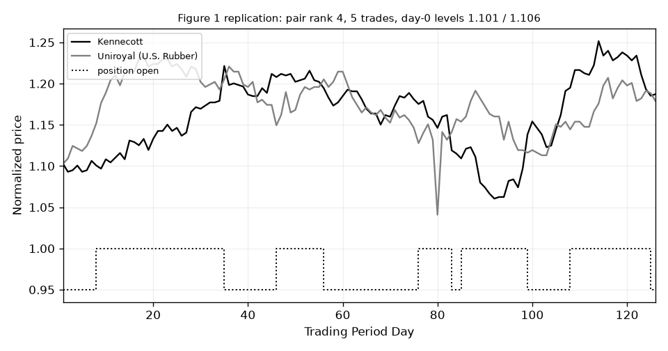

<!-- Generated by `scripts/03_replicate.py` (steps tables,table3,figure1,check) on 2026-10-17; copy of results/replication/tables/replication_check.md. -->

# Replication check: GGR (2006) Figure 1 and Tables 1-3 (vol_common)

Cells show ours / paper. ✓ within 10% of the paper, ~ within 25%, ✗ further.

## Summary

- Figure 1: reproduced
- Table 1: Cells: 88; ✓ 29 (within 10%), ~ 25 (within 25%), ✗ 34.
- Table 2 Panel A: Cells: 24; ✓ 13 (within 10%), ~ 8 (within 25%), ✗ 3.
- Table 2 Panel B: Cells: 40; ✓ 15 (within 10%), ~ 8 (within 25%), ✗ 17.
- Table 3: Cells: 139; ✓ 37 (within 10%), ~ 42 (within 25%), ✗ 60.

## Figure 1 (Kennecott vs Uniroyal, trading Aug 1963 - Jan 1964, no wait)

| check | ours | paper | match |
|---|---|---|---|
| pair formed (rank) | 4 | top 5 | ✓ |
| trades (open day, close day) | [(8, 35), (46, 56), (76, 83), (85, 99), (108, 125)] | [(7, 35), (46, 55), (74, 82), (86, 99), (108, 126)] (read off the chart) | ✓ (±3 days) |
| day-0 levels (formation end) | [1.1006, 1.106] | about 1.10 | ✓ |

## Table 1 Panel A (no wait)

| statistic | top5 | top20 | 101-120 | all |
|---|---|---|---|---|
| mean (fully invested) | 1.15% / 1.31% ~ | 1.19% / 1.44% ~ | 0.98% / 1.08% ✓ | 0.84% / 1.10% ~ |
| nw_se | 0.19% / 0.15% ✗ | 0.14% / 0.12% ~ | 0.09% / 0.09% ✓ | 0.10% / 0.10% ✓ |
| t_stat | 5.94 / 8.84 ✗ | 8.59 / 11.6 ✗ | 10.9 / 11.5 ✓ | 8.29 / 11.2 ✗ |
| median | 1.08% / 1.19% ✓ | 1.07% / 1.23% ~ | 0.82% / 0.95% ~ | 0.59% / 0.73% ~ |
| std | 2.98% / 2.28% ✗ | 1.86% / 1.69% ~ | 1.66% / 1.54% ✓ | 2.15% / 1.67% ✗ |
| skew | -1.56 / 0.62 ✗ | 0.394 / 1.39 ✗ | 1.12 / 1.34 ~ | 0.192 / 3.42 ✗ |
| kurtosis | 15.2 / 7.81 ✗ | 7.41 / 10.5 ✗ | 7.84 / 10.3 ~ | 25.4 / 25.2 ✓ |
| min | -20.33% / -10.57% ✗ | -6.97% / -6.63% ✓ | -3.72% / -3.86% ✓ | -18.62% / -2.72% ✗ |
| max | 13.65% / 14.72% ✓ | 10.51% / 13.30% ~ | 11.64% / 12.68% ✓ | 15.31% / 17.18% ~ |
| share_negative | 0.264 / 0.26 ✓ | 0.198 / 0.15 ✗ | 0.266 / 0.21 ✗ | 0.295 / 0.17 ✗ |
| mean (committed) | 0.62% / 0.78% ~ | 0.73% / 0.80% ✓ | 0.64% / 0.68% ✓ | 0.54% / 0.61% ~ |

## Table 1 Panel B (one-day wait)

| statistic | top5 | top20 | 101-120 | all |
|---|---|---|---|---|
| mean (fully invested) | 0.52% / 0.74% ✗ | 0.72% / 0.90% ~ | 0.77% / 0.80% ✓ | 0.62% / 0.71% ~ |
| nw_se | 0.16% / 0.12% ✗ | 0.11% / 0.10% ~ | 0.08% / 0.08% ✓ | 0.10% / 0.09% ✓ |
| t_stat | 3.19 / 6.26 ✗ | 6.26 / 9.29 ✗ | 9.34 / 9.4 ✓ | 6.38 / 7.92 ~ |
| median | 0.62% / 0.70% ~ | 0.66% / 0.69% ✓ | 0.64% / 0.69% ✓ | 0.39% / 0.41% ✓ |
| std | 2.74% / 2.10% ✗ | 1.66% / 1.53% ✓ | 1.55% / 1.44% ✓ | 2.04% / 1.58% ✗ |
| skew | -2.46 / 0.34 ✗ | -0.121 / 1.45 ✗ | 0.506 / 0.98 ✗ | -0.0759 / 3.32 ✗ |
| kurtosis | 20.7 / 10.6 ✗ | 7.01 / 16.1 ✗ | 5.01 / 7.78 ✗ | 26.3 / 25.7 ✓ |
| min | -21.11% / -12.63% ✗ | -7.62% / -8.22% ✓ | -4.88% / -4.27% ~ | -18.23% / -2.95% ✗ |
| max | 10.34% / 14.35% ✗ | 8.11% / 13.49% ✗ | 7.97% / 10.46% ~ | 14.31% / 16.32% ~ |
| share_negative | 0.361 / 0.35 ✓ | 0.287 / 0.23 ~ | 0.31 / 0.28 ~ | 0.346 / 0.32 ✓ |
| mean (committed) | 0.26% / 0.46% ✗ | 0.43% / 0.52% ~ | 0.50% / 0.50% ✓ | 0.39% / 0.40% ✓ |

Cells: 88; ✓ 29 (within 10%), ~ 25 (within 25%), ✗ 34.

## Table 2 Panel A (one-day wait)

| statistic | top5 | top20 | 101-120 | all |
|---|---|---|---|---|
| avg_price_deviation_trigger | 0.0327 / 0.0476 ✗ | 0.0414 / 0.0528 ~ | 0.0679 / 0.0756 ~ | 0.165 / 0.169 ✓ |
| avg_pairs_traded_per_period | 4.82 / 4.81 ✓ | 19.6 / 19.3 ✓ | 19.7 / 19.4 ✓ | 1.92e+03 / 1.94e+03 ✓ |
| avg_round_trips_per_pair | 2.29 / 2.02 ~ | 2.17 / 1.96 ~ | 1.9 / 1.78 ✓ | 1.7 / 1.62 ✓ |
| std_round_trips_per_pair | 0.81 / 0.62 ✗ | 0.481 / 0.4 ~ | 0.305 / 0.27 ~ | 0.168 / 0.16 ✓ |
| avg_time_open_months | 3.79 / 3.75 ✓ | 3.92 / 3.76 ✓ | 4.13 / 3.98 ✓ | 4.05 / 3.97 ✓ |
| std_time_open_months | 0.817 / 0.8 ✓ | 0.503 / 0.45 ~ | 0.449 / 0.38 ~ | 0.312 / 0.17 ✗ |

Cells: 24; ✓ 13 (within 10%), ~ 8 (within 25%), ✗ 3.

## Table 2 Panel B (composition)

| statistic | top5 | top20 | 101-120 | all |
|---|---|---|---|---|
| avg_size_decile | 4.17 / 2.54 ✗ | 4.01 / 2.71 ✗ | 4.21 / 3.41 ~ | 5.94 / 4.57 ✗ |
| weight_top3_deciles | 0.551 / 0.78 ✗ | 0.535 / 0.74 ✗ | 0.494 / 0.58 ~ | 0.284 / 0.4 ✗ |
| weight_top5_deciles | 0.723 / 0.91 ~ | 0.75 / 0.91 ~ | 0.689 / 0.79 ~ | 0.45 / 0.62 ✗ |
| share_mixed_decile_pairs | 0.675 / 0.66 ✓ | 0.73 / 0.69 ✓ | 0.79 / 0.75 ✓ | 0.796 / 0.82 ✓ |
| avg_decile_diff_mixed_pairs | 2 / 0.97 ✗ | 2.16 / 0.97 ✗ | 2.7 / 0.97 ✗ | 3.11 / 0.98 ✗ |
| weight_utilities | 0.579 / 0.72 ~ | 0.682 / 0.71 ✓ | 0.312 / 0.32 ✓ | 0.0903 / 0.08 ~ |
| weight_transportation | 0.0133 / 0.02 ✗ | 0.0118 / 0.02 ✗ | 0.0187 / 0.02 ✓ | 0.0297 / 0.03 ✓ |
| weight_financials | 0.178 / 0.11 ✗ | 0.158 / 0.13 ~ | 0.259 / 0.26 ✓ | 0.15 / 0.16 ✓ |
| weight_industrials | 0.23 / 0.15 ✗ | 0.148 / 0.14 ✓ | 0.41 / 0.4 ✓ | 0.73 / 0.73 ✓ |
| share_mixed_sector_pairs | 0.141 / 0.2 ✗ | 0.14 / 0.22 ✗ | 0.398 / 0.44 ✓ | 0.308 / 0.33 ✓ |

Cells: 40; ✓ 15 (within 10%), ~ 8 (within 25%), ✗ 17.

## Table 3 stocks per cohort

| sector | ours / paper |
|---|---|
| Utilities | 161 / 156 ✓ |
| Transportation | 61.3 / 61 ✓ |
| Financials | 352 / 371 ✓ |
| Industrials | 1.73e+03 / 1.73e+03 ✓ |

## Table 3: Utilities (fully invested, one-day wait)

| statistic | top5 | top20 | 101-120 | all |
|---|---|---|---|---|
| mean | 1.10% / 0.91% ~ | 1.23% / 1.08% ~ | 0.61% / 0.93% ✗ | 1.00% / 1.04% ✓ |
| t_stat | 8.34 / 7.37 ~ | 10.4 / 10.3 ✓ | 2.98 / 6.11 ✗ | 8.23 / 10.5 ~ |
| median | 1.03% / 0.83% ~ | 1.12% / 0.94% ~ | 0.49% / 0.66% ✗ | 0.97% / 0.97% ✓ |
| std | 2.18% / 2.15% ✓ | 1.71% / 1.65% ✓ | 3.07% / 2.64% ~ | 1.80% / 1.47% ~ |
| skew | -0.165 / 0.44 ✗ | 0.67 / 0.76 ~ | 0.861 / 0.66 ✗ | 0.627 / 1.39 ✗ |
| kurtosis | 8.95 / 13.7 ✗ | 8.86 / 12.4 ✗ | 9.57 / 5.52 ✗ | 7.66 / 12.7 ✗ |
| min | -13.45% / -12.35% ✓ | -7.93% / -8.75% ✓ | -10.62% / -7.87% ✗ | -6.16% / -3.52% ✗ |
| max | 10.00% / 16.56% ✗ | 10.59% / 12.73% ~ | 17.34% / 12.13% ✗ | 10.82% / 12.88% ~ |
| share_negative | 0.293 / 0.28 ✓ | 0.186 / 0.19 ✓ | 0.394 / 0.35 ~ | 0.222 / 0.18 ~ |

## Table 3: Transportation (fully invested, one-day wait)

| statistic | top5 | top20 | all |
|---|---|---|---|
| mean | 1.13% / 0.50% ✗ | 0.73% / 0.58% ✗ | 0.65% / 0.44% ✗ |
| t_stat | 5.95 / 2.98 ✗ | 5.2 / 4.26 ~ | 4.87 / 3.07 ✗ |
| median | 1.13% / 0.59% ✗ | 0.56% / 0.55% ✓ | 0.57% / 0.34% ✗ |
| std | 4.04% / 3.89% ✓ | 2.93% / 2.94% ✓ | 2.84% / 2.87% ✓ |
| skew | 0.17 / -0.5 ✗ | 0.168 / -0.11 ✗ | 0.419 / 0.53 ~ |
| kurtosis | 3.48 / 4.98 ✗ | 3.94 / 5 ~ | 3.87 / 5.89 ✗ |
| min | -9.86% / -19.57% ✗ | -10.01% / -12.47% ~ | -7.31% / -12.53% ✗ |
| max | 15.79% / 10.96% ✗ | 10.79% / 11.10% ✓ | 11.20% / 13.56% ~ |
| share_negative | 0.395 / 0.44 ~ | 0.395 / 0.42 ✓ | 0.409 / 0.44 ✓ |

## Table 3: Financials (fully invested, one-day wait)

| statistic | top5 | top20 | 101-120 | all |
|---|---|---|---|---|
| mean | 0.66% / 0.68% ✓ | 0.71% / 0.78% ✓ | 1.03% / 0.85% ~ | 0.75% / 0.73% ✓ |
| t_stat | 3.48 / 4.79 ✗ | 6.19 / 7.6 ~ | 9.6 / 7.12 ✗ | 7.62 / 7.62 ✓ |
| median | 0.57% / 0.56% ✓ | 0.71% / 0.61% ~ | 0.97% / 0.66% ✗ | 0.60% / 0.51% ~ |
| std | 3.32% / 2.60% ✗ | 2.01% / 1.79% ~ | 1.88% / 2.36% ~ | 1.91% / 1.81% ✓ |
| skew | -0.393 / 0.81 ✗ | -0.219 / 0.61 ✗ | 1.14 / 1.98 ✗ | 0.899 / 2.64 ✗ |
| kurtosis | 13.5 / 6.37 ✗ | 6.24 / 6.48 ✓ | 7.56 / 18.3 ✗ | 6.4 / 21.2 ✗ |
| min | -18.32% / -8.20% ✗ | -9.18% / -7.81% ~ | -3.24% / -10.05% ✗ | -5.49% / -4.45% ~ |
| max | 21.98% / 14.93% ✗ | 9.02% / 10.64% ~ | 12.21% / 19.58% ✗ | 10.77% / 17.21% ✗ |
| share_negative | 0.384 / 0.4 ✓ | 0.34 / 0.33 ✓ | 0.282 / 0.32 ~ | 0.325 / 0.34 ✓ |

## Table 3: Industrials (fully invested, one-day wait)

| statistic | top5 | top20 | 101-120 | all |
|---|---|---|---|---|
| mean | 0.52% / 0.49% ✓ | 0.58% / 0.61% ✓ | 0.83% / 0.66% ~ | 0.60% / 0.71% ~ |
| t_stat | 3.01 / 4.11 ✗ | 6.26 / 6.93 ✓ | 8.16 / 6.8 ~ | 5.59 / 7.52 ✗ |
| median | 0.70% / 0.29% ✗ | 0.61% / 0.55% ~ | 0.70% / 0.55% ✗ | 0.42% / 0.40% ✓ |
| std | 2.91% / 2.36% ~ | 1.76% / 1.60% ~ | 1.89% / 1.82% ✓ | 2.31% / 1.67% ✗ |
| skew | -1.37 / 0.4 ✗ | -0.168 / 0.43 ✗ | 0.804 / 0.94 ~ | -0.333 / 2.97 ✗ |
| kurtosis | 13.9 / 4.94 ✗ | 8.36 / 4.75 ✗ | 6.54 / 7.65 ~ | 32.2 / 20.9 ✗ |
| min | -20.62% / -10.02% ✗ | -8.41% / -4.79% ✗ | -6.19% / -5.41% ~ | -22.07% / -3.43% ✗ |
| max | 15.35% / 10.55% ✗ | 10.76% / 8.02% ✗ | 10.34% / 11.62% ~ | 17.80% / 16.07% ~ |
| share_negative | 0.354 / 0.42 ~ | 0.359 / 0.36 ✓ | 0.3 / 0.35 ~ | 0.367 / 0.34 ✓ |

Cells: 139; ✓ 37 (within 10%), ~ 42 (within 25%), ✗ 60.
